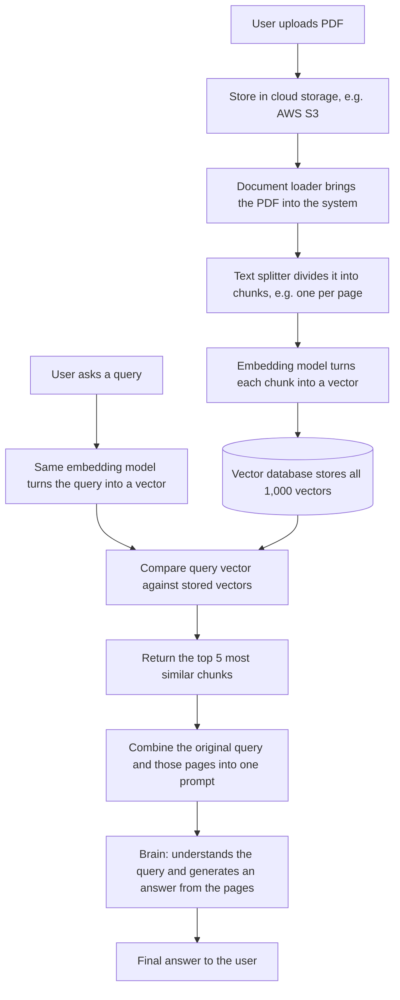

*Inspired by:* [YouTube](https://www.youtube.com/watch?v=nlz9j-r0U9U)

## Where This Series Starts

Generative AI has a huge, fast-moving vocabulary, but nearly every term in it falls on one of two sides of a **foundation model** (a very large model, like an LLM, trained on internet-scale data that can do many tasks instead of one):

- **The builder side:** creating foundation models. Transformer architectures, pre-training, optimization, fine-tuning, evaluation, and deployment. This is the work of research labs like OpenAI and Google.
- **The user side:** taking a foundation model that already exists and building applications on top of it. Calling LLMs through APIs or running open models locally, prompt engineering, RAG, agents, and deploying LLM apps.

This series focuses on the **user side**, and it starts with **LangChain**, the most popular framework for building LLM applications. It's a good first step because it touches nearly everything on the user side: closed and open-source models, prompts, RAG, and agents.

The series also teaches the **current LangChain (1.x)**. LangChain changes fast, and code written for older 0.x versions often won't run on 1.x, so when you follow any other tutorial, check which version it targets.

## 1. What Is LangChain?

In one sentence: **LangChain is an open-source framework for developing applications powered by LLMs.**

That sentence is accurate but doesn't tell you why anyone needs it. The best way to understand what a tool is for is to see the problem it solves. So instead of starting with LangChain, let's try to build an LLM application without it and see where it gets hard.

## 2. The App: Chat With Your PDF

Imagine a PDF reader app with one extra feature: a chat window. You upload a book, say a 1,000-page machine learning textbook, and besides reading it you can *talk* to it:

- "Explain page 5 like I'm a five-year-old."
- "Generate some true/false questions on linear regression so I can practise."
- "Make notes on the decision tree chapter."

That's genuinely useful: you're not just reading the book, you're having a conversation with it. How would you build it?

### The high-level flow

Say the user asks: **"What are the assumptions of linear regression?"**

**Step 1: find where the book talks about it.** Before anything can answer the question, you need to locate the relevant pages. That's a search problem, and there are two ways to search:

- **Keyword search** takes the words in the query ("assumptions", "linear", "regression") and finds every page they appear on. That's inefficient: "linear regression" might appear on a hundred pages, most of which have nothing to do with its assumptions. You get lots of pages and little meaning.
- **Semantic search** tries to understand the *meaning* of the query. It looks for pages that are *about* the assumptions of linear regression, not pages that happen to contain those words. You get fewer pages, but they're the right ones. Say it returns pages 372 and 461.

**Step 2: answer from those pages.** The query and the two pages go to the system's "brain," which needs two capabilities:

1. **Natural language understanding (NLU):** understand what the user is actually asking, whether they ask in English or Hindi.
2. **Context-aware text generation:** read the given pages, find the relevant part (the five assumptions), and write an answer grounded in those pages.

The brain reads pages 372 and 461, extracts the assumptions, writes them up, and that's the answer the user sees.

### Why not just give the brain the whole book?

If the brain can understand questions and answer from pages, why bother with search? Why not send all 1,000 pages along with the question?

Think of a student with a doubt. In one scenario, they hand their teacher the entire maths textbook and say, "I have a doubt in algebra." In the other, they say, "I have a doubt on page 155." The teacher answers the second student faster and better, because the question comes with exactly the context needed and nothing else.

The same is true here. Sending the whole book is far more computationally expensive (the model has to process 1,000 pages for every single question), and burying the two relevant pages inside 998 irrelevant ones makes it harder to produce a focused answer. Search first, then send only what matters.

## 3. How Semantic Search Actually Works

"Understand the meaning of the query" sounds like magic, so let's make it concrete.

Suppose you have three paragraphs: one about Virat Kohli, one about Jasprit Bumrah, and one about Rohit Sharma. The question is: **"How many runs has Virat scored?"** You know the answer is in the Kohli paragraph. How does code know?

**Convert text into vectors.** Each paragraph is converted into an **embedding**: a vector, i.e. a list of numbers, that represents the paragraph's *meaning*. Techniques for producing embeddings include word2vec, doc2vec, and BERT-based embeddings. The idea is the same in each: text in, a fixed-length set of numbers out, where texts with similar meanings get similar numbers. Say each embedding has 100 dimensions.

**Embed the query too.** The question is converted into a 100-dimensional vector the same way.

**Compare.** You now have four vectors in the same 100-dimensional space: three paragraphs and one query. Compute the similarity between the query vector and each paragraph vector. The paragraph whose vector is closest to the query is the one the question is about: the Kohli paragraph. That paragraph is then used to answer.

That's all semantic search is: **embed everything, embed the query, return whatever is nearest.**

## 4. The Full System Design

Now apply that to the PDF app. Here's the complete pipeline:

Walking through it:

1. **Store.** The uploaded PDF goes to cloud storage, say AWS S3.
2. **Load.** A **document loader** brings the PDF from storage into the system.
3. **Split.** A **text splitter** divides the document into smaller **chunks**. You can split by chapter, page, or paragraph; here we split by page, so a 1,000-page book becomes 1,000 chunks.
4. **Embed.** Each chunk goes through an **embedding model**, which returns a vector. Now you have 1,000 vectors.
5. **Store the vectors.** The embeddings go into a database built for vectors, so they can be queried later.
6. **Embed the query.** When the user asks a question, the query goes through the *same* embedding model. It has to be the same one: vectors from two different embedding models live in different spaces, and comparing them would be meaningless.
7. **Retrieve.** The query vector is compared against all stored vectors, and the closest ones come back. If you decide to return 5, you get the 5 most similar chunks, and from those, the corresponding pages.
8. **Generate.** The user's original query and those pages are combined into one prompt for the brain, which understands the query and generates an answer from the pages.

## 5. The Three Hard Problems

The design is clear. Building it is where the challenges show up.

### Challenge 1: building the brain

The hardest part is the brain itself: a component that can fully understand any query, *and* generate a relevant answer from given text. NLP worked on both problems for years. The breakthrough came in 2017 with the transformer paper, followed by BERT and GPT, and eventually large language models.

So this challenge is already solved: **an LLM has both capabilities**, natural language understanding and context-aware text generation. A problem that was enormous in 2015 is, today, "plug in an LLM." In the diagram, "brain" simply becomes "LLM."

### Challenge 2: running the LLM

Using an LLM as your brain means it has to run somewhere. LLMs are extremely heavy deep learning models trained on internet-scale data. Hosting one on your own servers is hard from an engineering point of view, and expensive.

This is solved too. The companies that build LLMs (OpenAI, Anthropic, Google) host their models on their own servers and expose them through an **API**. You send a question to the API, the model runs on their infrastructure, and the reply comes back. You never host the model, and you **pay only for what you use**: low usage means a low bill. So the brain becomes an "LLM API."

### Challenge 3: orchestrating everything

This is the one that's still left. Look at how many moving parts the system has:

- **Five components:** cloud storage (AWS S3), the text splitter, the embedding model, the vector database, and the LLM.
- **Six tasks:** loading the document, splitting the text, generating embeddings, managing the database, retrieval, and talking to the LLM.

All of them have to be wired together into one pipeline. Writing all of that from scratch is very difficult, and it's fragile. Suppose you've hand-coded the whole system around OpenAI's API, and then decide to switch to Google's Gemini because it's cheaper. All the code that talks to OpenAI has to be ripped out and rewritten for Gemini. Same if you move storage from AWS to GCP, or switch embedding models. Every component swap means rewriting the code around it.

**This is where LangChain comes in.** It gives you built-in, plug-and-play pieces for all of these components, so they work together without you writing the glue. Switching from OpenAI to Gemini becomes a change of about one line, because LangChain handles the interfacing behind the scenes.

Put together: in an LLM application, the LLM does the heavy lifting of understanding and generating. But running the *whole* application end to end, with all its moving components, is hard, especially while the technology is this new. LangChain's pitch is: **you focus on your idea; it handles the orchestration.**

## 6. What LangChain Gives You

### Chains

The concept LangChain is named after. A **chain** connects components and tasks into a pipeline: the output of one step automatically becomes the input of the next, without you writing that hand-off code.

In the PDF app, that's load the document, split it, embed it, store it, retrieve from it, and send the result to the LLM: a series of steps that becomes one chain. Chains don't have to be a straight line, either. You can build **sequential**, **parallel**, and **conditional** chains, which lets you express workflows of almost any complexity.

### Model-agnostic development

You can use any model and switch between them with minimal changes: OpenAI or Google, AWS or GCP. Your code base moves to a different component in a line or two. That lets you concentrate on your actual business logic instead of the plumbing around a particular vendor.

### A complete ecosystem

Every kind of component comes in many variants. There are document loaders for cloud storage, Excel files, PDFs, and much more; dozens of text splitters; many embedding models; many vector databases. Whatever component your company already works with, LangChain most likely has an interface for it.

### Memory and state

Suppose the user asks "What are the assumptions of linear regression?", gets an answer, and immediately follows up with "Also give me a few interview questions on this algorithm."

*Which* algorithm? On its own, the second query doesn't say. Without memory, the system has no record that the previous question was about linear regression, so it can't resolve "this algorithm." LangChain supports **conversation memory**: within a conversation, the model knows the earlier turns were about linear regression, even when the follow-up doesn't mention it. How memory works in current LangChain comes later in the series.

## 7. What People Build With LangChain

1. **Conversational chatbots.** Internet companies like Uber, Zomato, and Swiggy deal with huge numbers of customers at once. Staffing a call center for that is costly. Instead, a chatbot that understands customer queries handles the first layer of communication, and only the queries it can't resolve go to human agents.
2. **AI knowledge assistants.** A chatbot that also has access to *your* data. For example, an online course platform could add a chatbot to its lectures: a student watching a lecture asks a doubt, and the chatbot answers using what that lecture actually covers.
3. **AI agents.** Think of these as **chatbots on steroids**: they don't just talk, they do things. On a travel booking site, instead of clicking through forms, you tell an agent "book me the cheapest flight to Delhi," and it uses tools to actually do it. Agents are widely seen as the next big thing in AI, and LangChain can build them; this series builds a basic one.
4. **Workflow automation.** Using LLMs to automate workflows at a personal, professional, or company level.
5. **Summarization and research helpers.** You can't upload a very large book to a chat tool because of context length limits, and many companies forbid uploading private data to public chatbots. With LangChain, a company can build its own ChatGPT-like tool that processes documents of any size and can safely be given the company's private data.

## 8. Alternatives

LangChain isn't the only framework for building LLM applications. Two other popular ones are **LlamaIndex** and **Haystack**, and plenty of companies use them instead of LangChain. The choice usually comes down to which fits your use case better and which gives better pricing. Comparing them properly only makes sense once you know LangChain well, so for now it's enough to know they exist.

The next post looks at LangChain's components: the building blocks this whole pipeline is made of.
