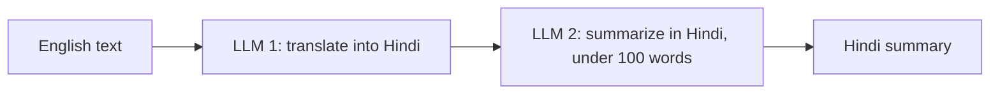
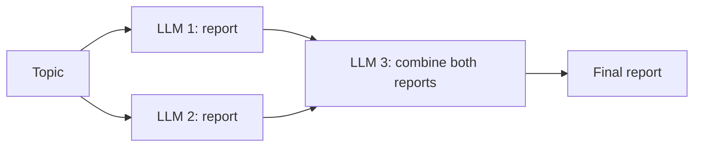
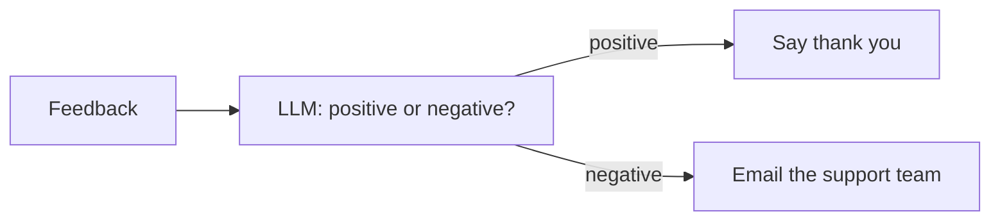

*Inspired by:* [YouTube](https://www.youtube.com/watch?v=-xSJA8-o6Eg)

## Why Look at the Components First

The [previous post](/genai-langchain/ch1-introduction-to-langchain) covered *why* LangChain exists: an LLM application has many moving parts (storage, splitters, embedding models, vector databases, the LLM itself), and wiring them together by hand is hard and fragile. LangChain's job is the orchestration: it lets you build pipelines out of those parts with very little glue code, it's model-agnostic, and its **chains** pass one step's output into the next automatically.

This post zooms in on *how* the framework is organized. Almost all of LangChain can be understood through six components:

1. **Models**
2. **Prompts**
3. **Chains**
4. **Indexes**
5. **Memory**
6. **Agents**

Understand these six and you understand most of LangChain, because every feature in the library belongs to one of them. They're also the roadmap for the rest of this series: each one gets its own detailed post later. So this post stays at the level of "what problem does this solve, and what does it look like," with small code examples to make each idea concrete.

One note on versions. These six are the classic way LangChain was organized, and the ideas behind them are unchanged. In LangChain 1.x some of them live under different names (indexes are now documented as **retrieval**, memory lives inside an agent's state), and the code below uses the current APIs. Where a name has changed, the section says so. Every code sample comes in Python and JavaScript: pick one with the tabs above any sample and the choice sticks across posts.

## 1. Models

Models are the most important component of LangChain. The official definition: **models are the core interfaces through which you interact with AI models.** That only makes sense with a bit of back story.

### The problem models solve

The most popular application in NLP (natural language processing, teaching computers to work with human language) has always been the chatbot, and building one meant solving two hard problems:

1. **Natural language understanding (NLU):** understanding what the user means. If I type "Hi, can you check my email?", the chatbot has to work out what I'm actually asking for.
2. **Context-aware text generation:** even if the chatbot understands the question, it has to write a correct, relevant reply.

LLMs solved both. But they brought a new problem: because they're trained on internet-scale data, they have billions of **parameters** (the numbers inside the model that it learned during training; more parameters means a bigger, heavier model), and many good LLMs are over 100 GB. An ordinary person can't run that on their own computer, and a small company can't afford to host it on cloud servers either; the bill would be enormous.

That problem was solved with **APIs**. Companies like OpenAI and Google keep the model on their own servers and put an API in front of it. Anyone can send a query to the API, the model runs on the provider's machines, and the response comes back. You never host anything, and you pay only for what you use.

Which leaves one more problem: **every provider wrote its API differently.** Here's the same question sent to OpenAI and to Anthropic using each company's own SDK (software development kit: the library a company gives you so your code can call its API without writing the raw internet requests yourself):

<CodeTabs>

```python
# OpenAI's SDK
from openai import OpenAI

client = OpenAI()
response = client.responses.create(model="gpt-5.5", input="What is the capital of India?")
print(response.output_text)
```

```js
// OpenAI's SDK
import OpenAI from "openai";

const client = new OpenAI();
const response = await client.responses.create({ model: "gpt-5.5", input: "What is the capital of India?" });
console.log(response.output_text);
```

</CodeTabs>

Expected output (not run here, since it needs a paid OpenAI key). The printed text is just the answer; the full `response` object behind it looks roughly like this, trimmed:

```
The capital of India is New Delhi.

Response(
    id='resp_...',
    model='gpt-5.5',
    output=[ResponseOutputMessage(
        role='assistant',
        content=[ResponseOutputText(text='The capital of India is New Delhi.', type='output_text')],
    )],
    usage=ResponseUsage(input_tokens=14, output_tokens=10, total_tokens=24),
)
```

The shortcut `response.output_text` digs the text out of `output[0].content[0].text` for you.

<CodeTabs>

```python
# Anthropic's SDK
import anthropic

client = anthropic.Anthropic()
response = client.messages.create(
    model="claude-sonnet-5-5",
    max_tokens=1024,
    messages=[{"role": "user", "content": "What is the capital of India?"}],
)
print(response.content[0].text)
```

```js
// Anthropic's SDK
import Anthropic from "@anthropic-ai/sdk";

const client = new Anthropic();
const response = await client.messages.create({
  model: "claude-sonnet-5-5",
  max_tokens: 1024,
  messages: [{ role: "user", content: "What is the capital of India?" }],
});
console.log(response.content[0].text);
```

</CodeTabs>

Expected output (not run here, since it needs a paid Anthropic key). Again the printed text is only the answer; the `response` object is shaped differently from OpenAI's, trimmed:

```
The capital of India is New Delhi.

Message(
    id='msg_...',
    model='claude-sonnet-5-5',
    role='assistant',
    content=[TextBlock(text='The capital of India is New Delhi.', type='text')],
    stop_reason='end_turn',
    usage=Usage(input_tokens=14, output_tokens=10),
)
```

Here the text sits in a list of content blocks, which is why you write `content[0].text`.

Different client classes, different method names, different required arguments (Anthropic insists on `max_tokens`), and the answer comes back in a differently shaped object (`output_text` versus `content[0].text`). Now imagine:

- Your application uses both models for different tasks: you write and maintain two styles of code.
- You built everything on OpenAI and want to switch to Claude because it's cheaper for your workload: every call site and every bit of response-parsing code has to be rewritten.

Multiply that by Gemini, Mistral, and every other provider, and **standardization** becomes the real challenge.

### LangChain's answer: one interface for every provider

LangChain's idea was: what if there were a single interface that could talk to *any* company's model in the same way? That interface is the models component.

<CodeTabs>

```python
from langchain.chat_models import init_chat_model

model = init_chat_model("openai:gpt-5.5")
# model = init_chat_model("anthropic:claude-sonnet-5-5")

result = model.invoke("What is the capital of India?")
print(result.content)
```

```js
import { initChatModel } from "langchain";

const model = await initChatModel("openai:gpt-5.5");
// const model = await initChatModel("anthropic:claude-sonnet-5-5");

const result = await model.invoke("What is the capital of India?");
console.log(result.content);
```

</CodeTabs>

Expected output (not run here, since it needs a paid key). The printed text is the same for any provider, and `result` itself is the same `AIMessage` shape whichever one you pick:

```
The capital of India is New Delhi.

AIMessage(
    content='The capital of India is New Delhi.',
    response_metadata={'model_name': 'gpt-5.5', 'finish_reason': 'stop', ...},
    usage_metadata={'input_tokens': 14, 'output_tokens': 10, 'total_tokens': 24},
)
```

With Claude, the metadata values change (`model_name`, token counts) but the fields stay the same, which is the whole point of the standard interface. Ch3 shows a real `AIMessage` from a live run.

Switching from OpenAI to Claude is the commented-out line: change the model string, install the matching integration package (a small add-on that teaches LangChain to talk to one company's models: `langchain-openai` and `langchain-anthropic` in Python, `@langchain/openai` and `@langchain/anthropic` in JavaScript), and nothing else moves. The call is the same `.invoke()`, and the reply comes back in the same shape for every provider: an `AIMessage` whose text is in `.content`. That second part matters as much as the first. Because responses are standardized too, the code that *parses* the model's output doesn't change either.

### Language models vs embedding models

LangChain can talk to two kinds of AI model:

- **Language models** (LLMs and chat models) work on a **text in, text out** basis. You send "How are you today?" and get back "I'm good, how about you?". Chatbots, agents, and most of what this series builds run on these.
- **Embedding models** take **text in and return a vector**: a list of numbers representing the text's meaning. Their main use is **semantic search**, which the previous post walked through. Embedding models have the same kind of unified entry point:

<CodeTabs>

```python
from langchain.embeddings import init_embeddings

embeddings = init_embeddings("openai:text-embedding-3-small")
```

```js
import { OpenAIEmbeddings } from "@langchain/openai";

// JS has no initEmbeddings; each provider's embeddings class shares one interface
const embeddings = new OpenAIEmbeddings({ model: "text-embedding-3-small" });
```

</CodeTabs>

> **Why the JavaScript tab looks different.** Python has a shortcut, `init_embeddings`, that reads the text before the colon (`"openai:"`) and picks the right provider class for you. LangChain.js has no such shortcut for embeddings (there is one for chat models, `initChatModel`, which is why that example looks alike in both languages). So in JavaScript you import the provider's class yourself, `OpenAIEmbeddings` from `@langchain/openai`, and create it directly. That means one extra import and a longer line, but the result is the same kind of object, with the same `embed_query` / `embedQuery` and `embed_documents` / `embedDocuments` methods. Python can use the same long form too: `from langchain_openai import OpenAIEmbeddings`, as ch3 does.

LangChain's docs keep a list of every [chat model](https://docs.langchain.com/oss/python/integrations/chat) and [embedding model](https://docs.langchain.com/oss/python/integrations/text_embedding) integration: OpenAI, Anthropic, Google, Mistral AI, Azure, AWS Bedrock, Hugging Face, Ollama, IBM, and many more. The chat model table also tells you which features each one supports, like tool calling (the model can ask your code to run a function, which agents need; covered later in this post), structured or JSON output (replies in a fixed data format, covered in ch5), running locally on your own machine, and multimodal input (accepting images or audio, not just text). It's worth skimming once just to see the landscape.

## 2. Prompts

A **prompt** is the input you send to an LLM. If you ask ChatGPT "What is CampusX?", that string is the prompt.

Prompts matter enormously, because an LLM's output is very sensitive to them. Ask a model to "explain linear regression in an academic tone," then ask it to "explain linear regression in a fun tone": one word changed, and you get two completely different answers. That sensitivity is why **prompt engineering** has become a field of its own, with job titles to match.

Since LangChain exists to build LLM-powered applications, and LLMs depend this heavily on prompts, it has a dedicated component for building them. Three examples show how flexible it is.

### Dynamic, reusable prompts

You don't know in advance which topic a user wants summarized, or in what tone. So instead of hard-coding the prompt, you write it once with **placeholders** and fill them in at runtime:

<CodeTabs>

```python
from langchain_core.prompts import PromptTemplate

template = PromptTemplate.from_template("Summarize {topic} in a {emotion} tone.")

print(template.invoke({"topic": "cricket", "emotion": "fun"}).to_string())
print(template.invoke({"topic": "biology", "emotion": "serious"}).to_string())
```

```js
import { PromptTemplate } from "@langchain/core/prompts";

const template = PromptTemplate.fromTemplate("Summarize {topic} in a {emotion} tone.");

console.log((await template.invoke({ topic: "cricket", emotion: "fun" })).toString());
console.log((await template.invoke({ topic: "biology", emotion: "serious" })).toString());
```

</CodeTabs>

```
Summarize cricket in a fun tone.
Summarize biology in a serious tone.
```

One template, reused for every user; only the values change.

### Role-based prompts

Chat models accept messages with roles. A **system** message sets up who the model should be; a **human** message is what the user asks. Both can have placeholders:

<CodeTabs>

```python
from langchain_core.prompts import ChatPromptTemplate

chat_template = ChatPromptTemplate.from_messages([
    ("system", "Hi, you are an experienced {profession}."),
    ("human", "Tell me about {topic}."),
])

prompt = chat_template.invoke({"profession": "doctor", "topic": "viral fever"})
for m in prompt.to_messages():
    print(f"{m.type}: {m.content}")
```

```js
import { ChatPromptTemplate } from "@langchain/core/prompts";

const chatTemplate = ChatPromptTemplate.fromMessages([
  ["system", "Hi, you are an experienced {profession}."],
  ["human", "Tell me about {topic}."],
]);

const prompt = await chatTemplate.invoke({ profession: "doctor", topic: "viral fever" });
for (const m of prompt.toChatMessages()) {
  console.log(`${m.type}: ${m.content}`);
}
```

</CodeTabs>

```
system: Hi, you are an experienced doctor.
human: Tell me about viral fever.
```

You're guiding the model: answer as an experienced doctor would. The next user might fill in "engineer" and "building bridges," and the same template produces a completely different conversation.

### Few-shot prompts

In **few-shot prompting** you show the LLM some solved examples first, then ask your real question. Suppose you're building a customer-support system that sorts incoming tickets into categories. You show the model a few past tickets with their correct labels, then hand it the new one:

<CodeTabs>

```python
from langchain_core.prompts import PromptTemplate, FewShotPromptTemplate

examples = [
    {"ticket": "I was charged twice for my subscription this month.", "category": "Billing Issue"},
    {"ticket": "The app crashes every time I try to log in.", "category": "Technical Problem"},
    {"ticket": "Can you explain how to upgrade my plan?", "category": "General Inquiry"},
]

example_prompt = PromptTemplate.from_template("Ticket: {ticket}\nCategory: {category}")

few_shot = FewShotPromptTemplate(
    examples=examples,
    example_prompt=example_prompt,
    prefix="Classify the following customer support tickets into one of the categories: "
           "'Billing Issue', 'Technical Problem', or 'General Inquiry'.",
    suffix="Ticket: {user_input}\nCategory:",
    input_variables=["user_input"],
)

print(few_shot.invoke({"user_input": "I am unable to connect to the internet using your service."}).to_string())
```

```js
import { PromptTemplate, FewShotPromptTemplate } from "@langchain/core/prompts";

const examples = [
  { ticket: "I was charged twice for my subscription this month.", category: "Billing Issue" },
  { ticket: "The app crashes every time I try to log in.", category: "Technical Problem" },
  { ticket: "Can you explain how to upgrade my plan?", category: "General Inquiry" },
];

const examplePrompt = PromptTemplate.fromTemplate("Ticket: {ticket}\nCategory: {category}");

const fewShot = new FewShotPromptTemplate({
  examples,
  examplePrompt,
  prefix:
    "Classify the following customer support tickets into one of the categories: " +
    "'Billing Issue', 'Technical Problem', or 'General Inquiry'.",
  suffix: "Ticket: {user_input}\nCategory:",
  inputVariables: ["user_input"],
});

console.log((await fewShot.invoke({ user_input: "I am unable to connect to the internet using your service." })).toString());
```

</CodeTabs>

```
Classify the following customer support tickets into one of the categories: 'Billing Issue', 'Technical Problem', or 'General Inquiry'.

Ticket: I was charged twice for my subscription this month.
Category: Billing Issue

Ticket: The app crashes every time I try to log in.
Category: Technical Problem

Ticket: Can you explain how to upgrade my plan?
Category: General Inquiry

Ticket: I am unable to connect to the internet using your service.
Category:
```

The template assembles the instruction, every example, and the new ticket into one prompt, ending at `Category:` so the model's natural next move is to fill in the label. The examples teach it the categories and the expected format far more reliably than a description alone.

Don't worry if these classes are new; the point here is the range of prompting techniques the component supports. Prompts get dedicated posts later.

## 3. Chains

Chains are important enough that the library is named after them. A chain is how you build a **pipeline** in LangChain, and almost any LLM application can be given the shape of a pipeline.

### A sequential chain

Say you're building an app where the user pastes about 1,000 words of English text, and the output is a **Hindi summary under 100 words**. You decide on this flow:



Without chains, you'd orchestrate it by hand: take the user's input, call the first LLM with a translation prompt, pull the Hindi text out of its response, build a second prompt around it, call the second LLM, pull the summary out of *that* response. At every stage you're manually extracting the output and feeding it into the next stage's input.

Chains remove that work. Their defining feature: **the output of one stage automatically becomes the input of the next.** In current LangChain you build a chain by joining components with the `|` operator (`.pipe()` in JavaScript). Think of it as a pipe in plumbing: whatever comes out of the left piece flows into the right piece.

In the code below, the **parser** is the piece that cleans up the model's reply. A model returns a message object, and a parser pulls out just the part you want, here the plain text:

<CodeTabs>

```python
from langchain.chat_models import init_chat_model
from langchain_core.prompts import PromptTemplate
from langchain_core.output_parsers import StrOutputParser

model = init_chat_model("openai:gpt-5.5")
parser = StrOutputParser()

translate = PromptTemplate.from_template("Translate this text into Hindi:\n\n{text}")
summarize = PromptTemplate.from_template("Summarize this Hindi text in Hindi, in under 100 words:\n\n{hindi_text}")

chain = translate | model | parser | summarize | model | parser

english_text = open("article.txt").read()   # ~1,000 words of English
print(chain.invoke({"text": english_text}))
```

```js
import { readFileSync } from "node:fs";
import { initChatModel } from "langchain";
import { PromptTemplate } from "@langchain/core/prompts";
import { StringOutputParser } from "@langchain/core/output_parsers";

const model = await initChatModel("openai:gpt-5.5");
const parser = new StringOutputParser();

const translate = PromptTemplate.fromTemplate("Translate this text into Hindi:\n\n{text}");
const summarize = PromptTemplate.fromTemplate("Summarize this Hindi text in Hindi, in under 100 words:\n\n{hindi_text}");

const chain = translate
  .pipe(model)
  .pipe(parser)
  .pipe((hindiText) => ({ hindi_text: hindiText })) // JS prompts take an object, not a bare string
  .pipe(summarize)
  .pipe(model)
  .pipe(parser);

const englishText = readFileSync("article.txt", "utf8"); // ~1,000 words of English
console.log(await chain.invoke({ text: englishText }));
```

</CodeTabs>

`StrOutputParser` (`StringOutputParser` in JavaScript) turns the model's `AIMessage` into a plain string, and that string flows into the `summarize` template's single placeholder. Python fills a lone placeholder from a bare string automatically; JavaScript prompts only take an object, hence the extra one-line step. You call the chain once with the English text, and everything else happens behind the scenes. Run on a short paragraph describing LangChain, it returned:

```
लैंगचेन एक ओपन‑सोर्स फ्रेमवर्क है जो बड़े भाषा मॉडलों से चलने वाले एप्लिकेशन बनाता है। यह मॉडल, प्रॉम्प्ट, रिट्रीवल, मेमोरी और एजेंट्स के लिए एकसमान इंटरफ़ेस देता है, जिससे डेवलपर बिना अतिरिक्त कोड के घटकों को पाइपलाइन में जोड़ सकते हैं। ...
```

This `|` (or `.pipe()`) syntax is called the **LangChain Expression Language (LCEL)**. Older tutorials build the same thing with classes like `LLMChain` and `SequentialChain`; those are gone from LangChain 1.x.

### Parallel chains

Chains don't have to be a straight line. Say the user enters a topic, like "the 9/11 attacks," and you want a detailed report that combines the work of more than one LLM: two LLMs each write a report on the topic *at the same time*, and a third merges them.



<CodeTabs>

```python
from langchain.chat_models import init_chat_model
from langchain_core.prompts import PromptTemplate
from langchain_core.output_parsers import StrOutputParser
from langchain_core.runnables import RunnableParallel

model = init_chat_model("openai:gpt-5.5")
parser = StrOutputParser()

report_a = PromptTemplate.from_template("Write a short factual report on {topic}.") | model | parser
report_b = PromptTemplate.from_template("Write a short report on the causes and aftermath of {topic}.") | model | parser
combine = PromptTemplate.from_template(
    "Merge these two reports into one, without repetition:\n\n1. {a}\n\n2. {b}"
) | model | parser

parallel_chain = RunnableParallel(a=report_a, b=report_b) | combine
parallel_chain.invoke({"topic": "the 9/11 attacks"})
```

```js
import { initChatModel } from "langchain";
import { PromptTemplate } from "@langchain/core/prompts";
import { StringOutputParser } from "@langchain/core/output_parsers";
import { RunnableParallel } from "@langchain/core/runnables";

const model = await initChatModel("openai:gpt-5.5");
const parser = new StringOutputParser();

const reportA = PromptTemplate.fromTemplate("Write a short factual report on {topic}.").pipe(model).pipe(parser);
const reportB = PromptTemplate.fromTemplate("Write a short report on the causes and aftermath of {topic}.").pipe(model).pipe(parser);
const combine = PromptTemplate.fromTemplate(
  "Merge these two reports into one, without repetition:\n\n1. {a}\n\n2. {b}"
).pipe(model).pipe(parser);

const parallelChain = RunnableParallel.from({ a: reportA, b: reportB }).pipe(combine);
await parallelChain.invoke({ topic: "the 9/11 attacks" });
```

</CodeTabs>

`RunnableParallel` (`RunnableParallel.from` in JavaScript) sends the same input to both branches and collects their outputs into a dictionary (a set of labelled values, written `{"a": ..., "b": ...}`, where each label points to one branch's result), which is exactly what the `combine` template needs.

### Conditional chains

A chain can also do different things depending on a condition. Say you're building a system that asks customers for feedback. An LLM reads the feedback: if it's positive, reply with a thank-you; if it's negative, immediately email the customer support team.



<CodeTabs>

```python
from langchain.chat_models import init_chat_model
from langchain_core.prompts import PromptTemplate
from langchain_core.output_parsers import StrOutputParser
from langchain_core.runnables import RunnableBranch, RunnableParallel

model = init_chat_model("openai:gpt-5.5")
parser = StrOutputParser()

classify = PromptTemplate.from_template(
    "Is this feedback positive or negative? Answer with one word.\n\n{feedback}"
) | model | parser

branch = RunnableBranch(
    (lambda x: "positive" in x["sentiment"].lower(), lambda x: "Thank you for your feedback!"),
    lambda x: f"Emailing support team about: {x['feedback']}",
)

conditional_chain = RunnableParallel(sentiment=classify, feedback=lambda x: x["feedback"]) | branch

print(conditional_chain.invoke({"feedback": "Loved the quick delivery!"}))
print(conditional_chain.invoke({"feedback": "My order arrived broken and nobody replied."}))
```

```js
import { initChatModel } from "langchain";
import { PromptTemplate } from "@langchain/core/prompts";
import { StringOutputParser } from "@langchain/core/output_parsers";
import { RunnableBranch, RunnableParallel } from "@langchain/core/runnables";

const model = await initChatModel("openai:gpt-5.5");
const parser = new StringOutputParser();

const classify = PromptTemplate.fromTemplate(
  "Is this feedback positive or negative? Answer with one word.\n\n{feedback}"
).pipe(model).pipe(parser);

const branch = RunnableBranch.from([
  [(x) => x.sentiment.toLowerCase().includes("positive"), () => "Thank you for your feedback!"],
  (x) => `Emailing support team about: ${x.feedback}`,
]);

const conditionalChain = RunnableParallel.from({ sentiment: classify, feedback: (x) => x.feedback }).pipe(branch);

console.log(await conditionalChain.invoke({ feedback: "Loved the quick delivery!" }));
console.log(await conditionalChain.invoke({ feedback: "My order arrived broken and nobody replied." }));
```

</CodeTabs>

```
Thank you for your feedback!
Emailing support team about: My order arrived broken and nobody replied.
```

`RunnableBranch` (`RunnableBranch.from` in JavaScript) checks each `(condition, action)` pair in order and runs the first action whose condition is true, falling back to the last one. (The "email" here is a stand-in string; a real system would call an email service at that point.) Sequential, parallel, and conditional pieces can be combined into pipelines of almost any complexity, and chains get their own detailed post later.

## 4. Indexes

The definition: **indexes connect your application to external knowledge, such as PDFs, websites, or databases.**

### The problem: the LLM hasn't seen your data

ChatGPT answers most questions well because it was trained on most of the internet. But say you work at a company called XYZ and ask ChatGPT "What is the leave policy of my company XYZ?" or "What is XYZ's notice period?" It can't answer. Those questions are about your company's **private data**, and ChatGPT never saw that data during training. We all hit this: anything specific to our own private or professional lives is out of reach.

The fix is to **connect the LLM to an external knowledge source**. Give it the company's entire rule book, and now it can answer both kinds of question: "Who is the Prime Minister of India?" from its training, and "What's XYZ's leave policy?" from the rule book.

### The four parts

Indexes are made of four components, and they're exactly the pipeline from the [chat-with-your-PDF app](/genai-langchain/ch1-introduction-to-langchain) in the previous post. Say the rule book is a 1,000-page PDF sitting in Google Drive or S3:

1. **Document loader:** brings the data in from wherever it lives. Any time you need to load data from some source, a document loader does it.
2. **Text splitter:** so that semantic search can work, breaks the document into small **chunks**, by page, paragraph, or chapter. Split by page, the rule book becomes 1,000 chunks.
3. **Vector store:** each chunk is turned into an embedding by an embedding model, giving 1,000 vectors. Since you'll search them today, the day after, and ten days later, they need to be saved somewhere. A database built to store vectors is a **vector database**, or **vector store**.
4. **Retriever:** when the user asks "What is the leave policy of XYZ?", the retriever embeds the query with the same embedding model, runs a semantic search against the vector store, and gets back the relevant chunks. Those chunks and the user's query go to the LLM, which writes the reply.

Together, these four do the heavy lifting of any LLM application that needs access to an external knowledge source, whether that source is PDFs, a website, or a company database.

In LangChain 1.x, "indexes" is no longer a named module; the docs file these pieces under **retrieval**. The four building blocks are all still there: document loaders (`langchain_community.document_loaders` and provider packages), text splitters (`langchain_text_splitters`), vector stores (`langchain_core.vectorstores` plus integrations with vector databases like Chroma, FAISS, and Pinecone), and retrievers (any vector store's `.as_retriever()`). Later posts build this pipeline for real.

## 5. Memory

Start with this statement: **LLM API calls are stateless.** It's a very important fact, and a big problem when you build LLM applications.

### What "stateless" means

Here's a model asked two questions, one after the other, as two separate calls:

<CodeTabs>

```python
from langchain.chat_models import init_chat_model

model = init_chat_model("openai:gpt-5.5")

print(model.invoke("Who is Narendra Modi? Answer in one sentence.").content)
print(model.invoke("How old is he?").content)
```

```js
import { initChatModel } from "langchain";

const model = await initChatModel("openai:gpt-5.5");

console.log((await model.invoke("Who is Narendra Modi? Answer in one sentence.")).content);
console.log((await model.invoke("How old is he?")).content);
```

</CodeTabs>

```
Narendra Modi is the Indian politician serving as the country’s Prime Minister since 2014, formerly Gujarat’s chief minister and a leading member of the Bharatiya Janata Party (BJP).

I’m not sure who you’re referring to. Could you let me know who “he” is, or give a bit more context? Then I’ll be happy to help!
```

The second call has no idea the first one happened, so it can't work out who "he" is. That's what stateless means: **every request is independent, with no memory of earlier requests.** Imagine a chatbot built like this. You'd have to remind it of the conversation on every single turn, which would be infuriating to use.

The memory component solves this by adding memory to a conversation.

### Kinds of memory

There are many approaches, but four come up most often:

- **Conversation buffer memory:** store the entire conversation so far, and send the full chat history along with every new API call. The model can now resolve "he." The catch: the history grows with every turn, and since you pay per **token** of text sent (a token is a small chunk of text, roughly three-quarters of a word), long conversations get expensive and eventually overflow the model's **context window** (the maximum amount of text the model can read in one call).
- **Conversation buffer window memory:** keep only the last N interactions, say the last 100 messages. The window keeps updating, so at any point the model sees the most recent stretch of conversation. That caps the cost, but anything older than the window is forgotten.
- **Summary memory:** generate a running summary of the chat history and send the summary instead of the full transcript. Less text goes out on each call, so it costs less, while the older context survives in compressed form.
- **Custom memory:** for advanced use cases, store specialized pieces of information permanently, like a user's preferences or key facts about them, so later conversations can draw on them.

### Memory in LangChain 1.x

The `ConversationBufferMemory`-style classes are gone from LangChain 1.x. Memory now lives in the agent's **state**, the information it carries from one step to the next, which includes the conversation so far. A **checkpointer** saves that state after every step, like a notebook where the agent writes down the chat. A `thread_id` is just a label for one conversation: every call with the same `thread_id` continues the same conversation, and a new `thread_id` starts a fresh one.

<CodeTabs>

```python
from langchain.agents import create_agent
from langgraph.checkpoint.memory import InMemorySaver

agent = create_agent(model="openai:gpt-5.5", checkpointer=InMemorySaver())
config = {"configurable": {"thread_id": "1"}}

agent.invoke({"messages": [{"role": "user", "content": "Who is Narendra Modi? Answer in one sentence."}]}, config)
result = agent.invoke({"messages": [{"role": "user", "content": "How old is he?"}]}, config)
print(result["messages"][-1].content)
```

```js
import { createAgent } from "langchain";
import { MemorySaver } from "@langchain/langgraph";

const agent = createAgent({ model: "openai:gpt-5.5", checkpointer: new MemorySaver() });
const config = { configurable: { thread_id: "1" } };

await agent.invoke({ messages: [{ role: "user", content: "Who is Narendra Modi? Answer in one sentence." }] }, config);
const result = await agent.invoke({ messages: [{ role: "user", content: "How old is he?" }] }, config);
console.log(result.messages.at(-1).content);
```

</CodeTabs>

```
As of 5 October 2026, Narendra Modi is 76 years old (born 17 September 1950).
```

Same two questions, but now the second call sees the first, and "he" resolves correctly. (`create_agent`, or `createAgent` in JavaScript, is LangChain's agent builder, covered in the next section; here it's used without any tools, just as a chat model with memory.)

Each of the four memory types maps onto this:

| Memory type | In LangChain 1.x |
|---|---|
| Buffer (full history) | The checkpointer on its own: the whole thread is kept and sent |
| Window (last N messages) | Trim older messages before each model call |
| Summary | `SummarizationMiddleware` (`summarizationMiddleware` in JavaScript; **middleware** is code that runs before or after each model call and can change what goes in or out), which replaces older messages with a summary once the history gets long |
| Custom (user facts, preferences) | **Long-term memory**: a store that is kept across conversations, not just within one thread, so the agent can remember you next week |

For example, summary memory is one extra argument:

<CodeTabs>

```python
from langchain.agents import create_agent
from langchain.agents.middleware import SummarizationMiddleware
from langgraph.checkpoint.memory import InMemorySaver

agent = create_agent(
    model="openai:gpt-5.5",
    checkpointer=InMemorySaver(),
    middleware=[SummarizationMiddleware(model="openai:gpt-5.5", trigger=("messages", 20), keep=("messages", 5))],
)
```

```js
import { createAgent, summarizationMiddleware } from "langchain";
import { MemorySaver } from "@langchain/langgraph";

const agent = createAgent({
  model: "openai:gpt-5.5",
  checkpointer: new MemorySaver(),
  middleware: [summarizationMiddleware({ model: "openai:gpt-5.5", trigger: { messages: 20 }, keep: { messages: 5 } })],
});
```

</CodeTabs>

Once the thread reaches 20 messages, the older ones are summarized into a single message and only the 5 most recent are kept verbatim. Memory is a very practical topic, and it gets a detailed treatment later in the series.

## 6. Agents

The agents component lets you build **AI agents** easily. Everyone is calling AI agents the next big thing, so let's build up what they are from scratch.

### From chatbot to agent

LLMs have two big strengths: understanding language (NLU) and generating text. The obvious first use for that was chatbots, and ChatGPT, the most popular AI application, is itself a chatbot. Then people asked: if a chatbot understands me well and can reply, why can't it also *do things* for me?

Say you're chatting with the chatbot on a travel site like MakeMyTrip and ask, "What's the best place in India to travel to in summer?" The chatbot runs on an LLM trained on internet data, which knows hill stations are popular in summer, so it replies "You could go to Shimla or Manali." That's as far as a chatbot goes.

An **AI agent** can go further:

- "What's the cheapest flight from Delhi to Shimla on 24th January?" The agent calls a flight-search API and comes back with the cheapest IndiGo flight.
- "Can you book that flight?" The agent has that capability too, so it books it on the site.

That's the difference: **an AI agent is a chatbot with superpowers.** It has two things a chatbot doesn't:

1. **Reasoning capability:** it can work out what it needs to do, step by step.
2. **Access to tools:** like a flight-search API it can call to get real information or take real actions.

### How an agent works: a walkthrough

Give an agent two tools: a **calculator**, for any arithmetic it needs during a conversation, and a **weather API**, which returns the temperature of any city on any date. A user asks:

> "Can you multiply today's temperature of Delhi with 3?"

One popular reasoning technique is **chain-of-thought prompting**, where the agent breaks the query down step by step:

1. "I need to multiply today's Delhi temperature by 3. So first I need today's temperature in Delhi."
2. It checks its tools: is there one that gives temperatures? Yes, the weather API. It calls it with `Delhi`, and gets back **25 °C**.
3. "Now I need to multiply 25 by 3, which needs the calculator." It checks its tools again, finds the calculator, and calls it with 25, 3, and multiplication. The result is **75**.
4. 75 is the final answer.

Here's that agent in current LangChain, with the weather API faked so that it always returns 25 °C (a real one would call a weather service):

<CodeTabs>

```python
from langchain.agents import create_agent
from langchain.tools import tool

@tool
def get_weather(city: str) -> str:
    """Get today's temperature for a city."""
    return f"{city}: 25 degree Celsius"   # stand-in for a real weather API

@tool
def multiply(a: float, b: float) -> float:
    """Multiply two numbers."""
    return a * b

agent = create_agent(model="openai:gpt-5.5", tools=[get_weather, multiply])

result = agent.invoke(
    {"messages": [{"role": "user", "content": "Can you multiply today's temperature of Delhi with 3?"}]}
)

for m in result["messages"]:
    if m.type == "ai" and m.tool_calls:
        for tc in m.tool_calls:
            print("AI calls tool:", tc["name"], tc["args"])
    elif m.type == "tool":
        print("Tool returns:", m.content)
    else:
        print(f"{m.type}: {m.content}")
```

```js
import { createAgent, tool } from "langchain";
import * as z from "zod";

const getWeather = tool(
  ({ city }) => `${city}: 25 degree Celsius`, // stand-in for a real weather API
  {
    name: "get_weather",
    description: "Get today's temperature for a city.",
    schema: z.object({ city: z.string() }),
  },
);

const multiply = tool(({ a, b }) => a * b, {
  name: "multiply",
  description: "Multiply two numbers.",
  schema: z.object({ a: z.number(), b: z.number() }),
});

const agent = createAgent({ model: "openai:gpt-5.5", tools: [getWeather, multiply] });

const result = await agent.invoke({
  messages: [{ role: "user", content: "Can you multiply today's temperature of Delhi with 3?" }],
});

for (const m of result.messages) {
  if (m.type === "ai" && m.tool_calls?.length) {
    for (const tc of m.tool_calls) console.log("AI calls tool:", tc.name, tc.args);
  } else if (m.type === "tool") {
    console.log("Tool returns:", m.content);
  } else {
    console.log(`${m.type}: ${m.content}`);
  }
}
```

</CodeTabs>

The printed trace shows the agent doing exactly what the walkthrough described:

```
human: Can you multiply today's temperature of Delhi with 3?
AI calls tool: get_weather {'city': 'Delhi'}
Tool returns: Delhi: 25 degree Celsius
AI calls tool: multiply {'a': 25, 'b': 3}
Tool returns: 75.0
ai: The product of today’s temperature in Delhi (25 °C) multiplied by 3 is **75**.
```

Nobody told it which tool to use first. The model read the tool descriptions, worked out that it needed the temperature before it could multiply, called the tools in that order, and only then answered. (Those descriptions matter: in Python it's the **docstring**, the text in triple quotes right under the function's name, and in JavaScript the `description` field. It's the only way the model knows what each tool does, so write it clearly.)

So the whole difference between an AI agent and a chatbot comes down to **reasoning plus tools**: an agent is an evolved chatbot that can take actions. It's where much of the AI industry is converging right now, and this series builds a full agent later.

## The Map

| Component | Problem it solves |
|---|---|
| **Models** | Every LLM provider's API is different; one standard interface talks to all of them |
| **Prompts** | LLM output is very sensitive to input; build dynamic, role-based, and few-shot prompts systematically |
| **Chains** | Hand-wiring each step's output into the next step's input; build sequential, parallel, and conditional pipelines |
| **Indexes** | The LLM has never seen your private data; load, split, store, and retrieve external knowledge |
| **Memory** | LLM API calls are stateless; keep conversation history (full, windowed, summarized, or custom) |
| **Agents** | Chatbots can only talk; give the LLM reasoning and tools so it can act |

The next post starts on the first of these, models, in detail.
