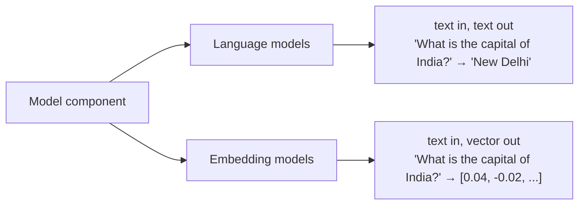

*Inspired by:* [YouTube](https://www.youtube.com/watch?v=HdcLE8JuMrA)

## From Concepts to Code

The [previous post](/genai-langchain/ch2-langchain-components) mapped LangChain's six components. This one starts writing real code, beginning with the first and most important component: **models**.

The **model component** is LangChain's common interface for talking to AI models. Every company's API works differently; the model component hides those differences so the same code shape works for all of them. It supports two kinds of model:



- **Language models** take text and return text. You build chatbots, assistants, and agents with these.
- **Embedding models** take text and return a vector of numbers that captures its meaning. You use these for **semantic search**, the core of RAG applications (retrieval-augmented generation: first look up the relevant text, then let the model answer from it) like the chat-with-your-PDF app from the [first post](/genai-langchain/ch1-introduction-to-langchain).

The plan: language models first, both closed-source (OpenAI, Anthropic, Google) and open-source (Hugging Face), then embedding models from both worlds, and finally a small document-similarity app that ties it together.

## Language Models: LLMs vs Chat Models

Language models themselves come in two types.

**LLMs** are general-purpose models: text generation, summarization, translation, question answering, code generation. Their interface is the simplest possible one: **a plain string goes in, a plain string comes out.**

**Chat models** are language models specialized for conversation. Their interface is different: **a sequence of messages goes in, and a message comes out.** That one change in input format is what everything else in this table follows from:

| | LLMs | Chat models |
|---|---|---|
| **Purpose** | Free-form text generation, summarization, translation, Q&A | Multi-turn conversations between a user and an AI |
| **Training** | Trained on general text (books, articles, Wikipedia) | Same pretraining (the first, expensive round of learning from huge amounts of text), then **fine-tuned on conversations** (trained a little further on chat logs, forum threads, user–assistant dialogues) |
| **Input / output** | One string in, one string out | A list of messages in, one message out |
| **Memory** | No concept of conversation history | Conversation history can be passed in as earlier messages |
| **Role awareness** | No roles | Understands **system**, **user**, and **AI** roles |
| **Example models** | Base (non-chat) models like GPT-3 davinci, Llama 3 8B base | GPT models behind ChatGPT, Claude, Gemini, Llama 3 Instruct |
| **Use cases** | Text generation, summarization, translation, code generation | Chatbots, virtual assistants, customer support, AI tutors, agents |

It's worth being precise about *why* a chat model handles "you are an experienced doctor" better. It isn't that a plain LLM doesn't know what a doctor is; it learned that in pretraining. The difference is structural. A chat model receives messages tagged with roles, so the instruction about who it should be arrives in its own **system** message, separate from what the user asked. And because it was fine-tuned on conversations laid out exactly this way, it has learned to treat the system message as "this is who you are" and the human message as "this is what to answer." A plain LLM gets one undifferentiated string and has to guess which part is an instruction and which part is the question. Memory works the same way: a chat model doesn't remember anything by itself; the earlier turns are simply sent back in as messages, a structure an LLM has no slot for.

LangChain mirrors this split in its code: every LLM class inherits from `BaseLLM`, every chat model class from `BaseChatModel`. (A class "inherits" from another when it reuses that class's code and adds to it; here it just means they share a common base.)

**LLMs are on their way out.** LangChain recommends chat models for all new work, and the providers agree: OpenAI shut down its last text-completion models (`gpt-3.5-turbo-instruct`, `davinci-002`, `babbage-002`) on 28 September 2026, so LangChain's old `OpenAI` LLM class has no OpenAI model left to call. Plain LLMs still exist in the open-source world, and the Hugging Face section below shows one being wrapped into a chat model. Everything else in this post uses chat models.

## Setup

Create a project folder, open it in your editor, and set up an isolated environment. A **virtual environment** is a private folder of installed packages that belongs to this project only, so installing LangChain here can't clash with other projects on your computer:

```bash
# Python: create and activate a virtual environment, then install
python -m venv venv
source venv/bin/activate          # Windows: venv\Scripts\activate
pip install langchain langchain-groq langchain-openai langchain-anthropic langchain-google-genai \
            langchain-huggingface transformers torch sentence-transformers python-dotenv scikit-learn

# JavaScript: in a new folder (with "type": "module" in package.json)
npm install langchain @langchain/core @langchain/groq @langchain/openai @langchain/anthropic \
            @langchain/google-genai @langchain/community @huggingface/transformers@3 dotenv
```

To confirm the install worked, print the version: `python -c "import langchain; print(langchain.__version__)"` should show 1.x (these examples were run on 1.4.7).

An **API key** is a long secret string, like a password, that tells the provider who is making the request (and who to bill). API keys never go in your code, because anyone who sees the code would see the key. They go in a `.env` file in the project folder, a plain text file of `NAME=value` lines, and `load_dotenv()` (Python) or `import "dotenv/config"` (JavaScript) loads them into the environment at runtime:

```
GROQ_API_KEY="..."
OPENAI_API_KEY="..."
ANTHROPIC_API_KEY="..."
GOOGLE_API_KEY="..."
HUGGINGFACEHUB_API_TOKEN="..."
```

Use these **exact** variable names. Each integration looks for one specific name (`ChatOpenAI` reads `OPENAI_API_KEY`, and so on); rename it and the class won't find your key.

**A note on cost.** OpenAI and Anthropic only issue usable API keys once you've bought credit (OpenAI's minimum top-up is $5), and that's still worth doing eventually, because most companies building LLM applications use them. To keep every example in this post runnable for free, though, the live demos use **[Groq](https://console.groq.com/keys)**, which has a free tier, running OpenAI's open-weights model `gpt-oss-20b`. Because of LangChain's common interface, switching to OpenAI, Claude, or Gemini later is a one-line change, shown further down.

## Your First Chat Model

<CodeTabs>

```python
from langchain_groq import ChatGroq
from dotenv import load_dotenv

load_dotenv()

model = ChatGroq(model="openai/gpt-oss-20b")

result = model.invoke("What is the capital of India")

print(result)
```

```js
import "dotenv/config";
import { ChatGroq } from "@langchain/groq";

const model = new ChatGroq({ model: "openai/gpt-oss-20b" });

const result = await model.invoke("What is the capital of India");

console.log(result);
```

</CodeTabs>

```
content='The capital of India is **New\u202fDelhi**.' additional_kwargs={'reasoning_content': 'We need to answer: The capital of India is New Delhi. Provide concise answer.'} response_metadata={'token_usage': {'completion_tokens': 38, 'prompt_tokens': 77, 'total_tokens': 115, 'completion_time': 0.052304208, 'completion_tokens_details': {'reasoning_tokens': 18}, 'prompt_time': 0.004007419, 'prompt_tokens_details': None, 'queue_time': 0.382184807, 'total_time': 0.056311627}, 'model_name': 'openai/gpt-oss-20b', 'system_fingerprint': 'fp_5979a0e1b7', 'service_tier': 'on_demand', 'finish_reason': 'stop', 'logprobs': None, 'model_provider': 'groq'} id='lc_run--01a17f5c-d777-74b4-9404-af0438724732-0' tool_calls=[] invalid_tool_calls=[] usage_metadata={'input_tokens': 77, 'output_tokens': 38, 'total_tokens': 115, 'output_token_details': {'reasoning': 18}}
```

(The JavaScript version prints the same object as an `AIMessage { ... }` structure.)

This is not plain text: it's an **`AIMessage`**. The answer lives in `content`; around it sits metadata (extra information about the reply): how many tokens the prompt and the completion used (a **token** is a small chunk of text, roughly three-quarters of a word; more on tokens under Max Tokens below), which model replied, and why it stopped (`finish_reason`). Two details are worth noticing:

- The question is seven words, yet `prompt_tokens` is **77**. That's the chat-model interface at work: LangChain wrapped the plain string in a human message, and the provider laid it out in the model's chat format, with role markers and a default system section, before the model ever saw it.
- `gpt-oss-20b` is a **reasoning model**: before writing the visible answer it "thinks" in hidden reasoning tokens (shown under `reasoning_content` and counted in `reasoning_tokens`). This becomes important for max tokens below.

Most of the time you only want the answer, so read `.content`:

<CodeTabs>

```python
from langchain_groq import ChatGroq
from dotenv import load_dotenv

load_dotenv()

model = ChatGroq(model="openai/gpt-oss-20b")

result = model.invoke("What is the capital of India")

print(result.content)
```

```js
import "dotenv/config";
import { ChatGroq } from "@langchain/groq";

const model = new ChatGroq({ model: "openai/gpt-oss-20b" });

const result = await model.invoke("What is the capital of India");

console.log(result.content);
```

</CodeTabs>

```
The capital of India is **New Delhi**.
```

`.invoke()` is how you run almost everything in LangChain: models, prompts, and chains all share it. Why they share it is the subject of a later post on Runnables.

### Passing roles explicitly

Passing a string is a shortcut. Under the hood a chat model always works with messages, and you can pass them yourself, which is how you give it a role:

<CodeTabs>

```python
from langchain_groq import ChatGroq
from langchain_core.messages import SystemMessage, HumanMessage
from dotenv import load_dotenv

load_dotenv()

model = ChatGroq(model="openai/gpt-oss-20b")

messages = [
    SystemMessage(content="You are an experienced doctor. Answer in two sentences."),
    HumanMessage(content="Tell me about viral fever."),
]

result = model.invoke(messages)

print(result.content)
```

```js
import "dotenv/config";
import { ChatGroq } from "@langchain/groq";
import { SystemMessage, HumanMessage } from "@langchain/core/messages";

const model = new ChatGroq({ model: "openai/gpt-oss-20b" });

const messages = [
  new SystemMessage("You are an experienced doctor. Answer in two sentences."),
  new HumanMessage("Tell me about viral fever."),
];

const result = await model.invoke(messages);

console.log(result.content);
```

</CodeTabs>

```
A viral fever is an acute illness caused by various viruses—such as influenza, dengue, or chikungunya—that triggers a systemic inflammatory response, leading to fever, malaise, and often headache or myalgia. Management is usually supportive, focusing on rest, hydration, antipyretics, and monitoring for complications, while antiviral therapy may be indicated for specific viruses like influenza.
```

The system message set the persona and the format (two sentences); the human message carried the question. This is the role awareness from the table above, in code.

## Temperature: Controlling Creativity

You can tune a chat model's behaviour with parameters. The most useful one is **temperature**: a number from 0 to 2 that controls how random the output is. Low values make the model pick its most likely next words, so answers are deterministic (the same input gives the same output) and predictable; high values let it pick less likely words, so answers become creative and diverse.

| Use case | Temperature |
|---|---|
| Factual answers: math, code, data extraction | 0 to 0.3 |
| General Q&A, explanations | 0.5 to 0.7 |
| Creative writing, storytelling, jokes | 0.9 to 1.2 |
| Maximum randomness: brainstorming, wild ideas | 1.5 and above |

Here's a poem at temperature 0:

<CodeTabs>

```python
from langchain_groq import ChatGroq
from dotenv import load_dotenv

load_dotenv()

model = ChatGroq(model="openai/gpt-oss-20b", temperature=0)

result = model.invoke("Write a 5 line poem on cricket")

print(result.content)
```

```js
import "dotenv/config";
import { ChatGroq } from "@langchain/groq";

const model = new ChatGroq({ model: "openai/gpt-oss-20b", temperature: 0 });

const result = await model.invoke("Write a 5 line poem on cricket");

console.log(result.content);
```

</CodeTabs>

```
In the dusk-lit field, the willow sings its song,  
A ball arcs, a bat, a dance where hearts belong.  
The crowd exhales as wickets fall in grace,  
Each run a story etched upon the space.  
Cricket’s rhythm, timeless, keeps the world in pace.
```

Running it again produced exactly the same poem, word for word (and the JavaScript version produced that same poem too). Now change `temperature=0` to `temperature=1.5` and run it twice:

```
In green grass, a willow hums the game’s quiet hymn,  
The ball arcs like a comet’s tail across the sun.  
Crowds cheer as wickets spin like turning dice,  
Runs added in whispers, the crowd’s pulse rises,  
Each over a heartbeat, in cricket’s timeless hymn.
```

```
On a sun‑kissed green, the batter reads the dot‑s,  
The willow sings as the seam glides over night.  
Catches snap, a glove catching a perfect echo,  
The crowd erupts in hushed joy while innings breathe.  
In that pause, the heart of sport beats pure delight.
```

Two different poems, neither of them the temperature-0 one. That's the knob in action: for a SQL generator you want the first behaviour, for brainstorming startup names you want the second. Swap them and you get bland, repetitive names and a SQL query that varies between runs and can come out wrong.

One honest caveat: temperature 0 means *nearly* deterministic, not guaranteed. Asking the same model for "5 Indian male names" at temperature 0 twice gave two different lists. Hosted APIs batch requests on GPUs (graphics chips that do the heavy math for AI models), and tiny rounding differences in the computer's decimal arithmetic can occasionally tip the choice between two almost equally likely words. Don't build anything that depends on byte-identical output.

## Max Tokens: Capping the Output

Paid models charge **per token**, priced per million tokens, for both input and output. A **token** is roughly a word, though not exactly (tokenization is its own topic). Capping the output length protects you from a user who asks for a 1,300-page essay: the model stops when it hits the cap, and so does the bill.

<CodeTabs>

```python
from langchain_groq import ChatGroq
from dotenv import load_dotenv

load_dotenv()

model = ChatGroq(model="openai/gpt-oss-20b", temperature=1.5, max_tokens=10)

result = model.invoke("Write a 5 line poem on cricket")

print(repr(result.content))
print(result.response_metadata["finish_reason"])
print(result.usage_metadata)
```

```js
import "dotenv/config";
import { ChatGroq } from "@langchain/groq";

const model = new ChatGroq({ model: "openai/gpt-oss-20b", temperature: 1.5, maxTokens: 10 });

const result = await model.invoke("Write a 5 line poem on cricket");

console.log(JSON.stringify(result.content));
console.log(result.response_metadata.finish_reason);
console.log(result.usage_metadata);
```

</CodeTabs>

```
''
length
{'input_tokens': 79, 'output_tokens': 10, 'total_tokens': 89, 'output_token_details': {'reasoning': 8}}
```

The content is **empty**. `finish_reason` is `length`, so the model did hit the cap, but 8 of its 10 tokens went to hidden reasoning, and it ran out before writing a single visible word. (Raising the cap to 60 still came back empty; at default effort the model reasoned for 52 tokens.) This is the modern twist on max tokens: **for reasoning models, the cap covers thinking plus answer.** The fix is to give the budget room, or to tell the model to think less:

<CodeTabs>

```python
from langchain_groq import ChatGroq
from dotenv import load_dotenv

load_dotenv()

model = ChatGroq(model="openai/gpt-oss-20b", temperature=1.5, max_tokens=30, reasoning_effort="low")

result = model.invoke("Write a 5 line poem on cricket")

print(repr(result.content))
print(result.response_metadata["finish_reason"])
print(result.usage_metadata)
```

```js
import "dotenv/config";
import { ChatGroq } from "@langchain/groq";

const model = new ChatGroq({
  model: "openai/gpt-oss-20b",
  temperature: 1.5,
  maxTokens: 30,
  reasoningEffort: "low",
});

const result = await model.invoke("Write a 5 line poem on cricket");

console.log(JSON.stringify(result.content));
console.log(result.response_metadata.finish_reason);
console.log(result.usage_metadata);
```

</CodeTabs>

```
'In the bright sun’s slow‑grace, the field'
length
{'input_tokens': 79, 'output_tokens': 30, 'total_tokens': 109, 'output_token_details': {'reasoning': 10}}
```

Now 10 tokens went to reasoning and the rest to the poem, which stops mid-line exactly where the budget ran out. That's what a token cap does: it doesn't make the model write a shorter poem, it cuts the poem off.

The parameter names differ slightly by provider: `ChatGroq` calls it `max_tokens`; `ChatOpenAI` accepts `max_completion_tokens` (an alias for its `max_tokens`); in JavaScript it's `maxTokens` everywhere. (The JavaScript `usage_metadata` reports the token totals but not the reasoning split.)

## Switching Providers: OpenAI, Claude, and Gemini

This is where the model component earns its keep. Each provider has its own integration package and class, but once the object exists, the code is identical:

<CodeTabs>

```python
from langchain_openai import ChatOpenAI
from langchain_anthropic import ChatAnthropic
from langchain_google_genai import ChatGoogleGenerativeAI
from dotenv import load_dotenv

load_dotenv()

models = [
    ChatOpenAI(model="gpt-6-astra"),                    # needs OPENAI_API_KEY
    ChatAnthropic(model="claude-sonnet-5-5"),           # needs ANTHROPIC_API_KEY
    ChatGoogleGenerativeAI(model="gemini-3.8-flash"),   # needs GOOGLE_API_KEY
]

for model in models:
    result = model.invoke("What is the capital of India")
    print(result.text)
```

```js
import "dotenv/config";
import { ChatOpenAI } from "@langchain/openai";
import { ChatAnthropic } from "@langchain/anthropic";
import { ChatGoogleGenerativeAI } from "@langchain/google-genai";

const models = [
  new ChatOpenAI({ model: "gpt-6-astra" }), // needs OPENAI_API_KEY
  new ChatAnthropic({ model: "claude-sonnet-5-5" }), // needs ANTHROPIC_API_KEY
  new ChatGoogleGenerativeAI({ model: "gemini-3.8-flash" }), // needs GOOGLE_API_KEY
];

for (const model of models) {
  const result = await model.invoke("What is the capital of India");
  console.log(result.text);
}
```

</CodeTabs>

Expected output (not run here, since OpenAI and Anthropic need paid keys and Gemini needs a Google key). Each model prints its own wording, but each one prints plain text, because `.text` always returns the answer as a string:

```
The capital of India is New Delhi.
The capital of India is New Delhi.
The capital of India is New Delhi.
```

The three lines come from three different models. Their wording will differ from run to run (one may add "It is also the seat of the government"); what stays the same is the shape: a string.

Each class needs its own key: OpenAI and Anthropic require paid credit, while Google's Gemini API has a free tier you can get from [Google AI Studio](https://aistudio.google.com/apikey). [Claude](https://www.anthropic.com/claude) comes from Anthropic, Gemini from Google, and both are as common in industry as OpenAI's models, so the company you work for might use any of the three. Each also accepts `temperature` and a max-tokens parameter, just like `ChatGroq` above.

Two things here differ from older tutorials:

- **Model names.** `gpt-4`, `claude-3-5-sonnet`, and `gemini-1.5-pro` have all been retired. The names above are current as of October 2026; check each provider's model list ([OpenAI](https://developers.openai.com/api/docs/models), [Anthropic](https://docs.anthropic.com/en/docs/about-claude/models), [Google](https://ai.google.dev/gemini-api/docs/models)), since they change often and each listing shows the model's context window and maximum output tokens.
- **`.text` instead of `.content`.** For Gemini 3 and later (and for any model returning reasoning blocks), `.content` is a *list* of content blocks rather than a string. `.text` always returns the plain answer text, whichever provider you're using.

The [previous post](/genai-langchain/ch2-langchain-components) showed one more way to do this switch: `init_chat_model("openai:gpt-6-astra")` picks the right class from a single model string.

## Open-Source Models

Every closed-source model above follows the same setup: the model sits on the company's servers, and the company puts an API in front of it. That has two flaws: **you pay for every call**, and **you have no control**, because the model lives on someone else's machine.

**Open-source models** fix both. They are freely available models that you can download, modify, fine-tune, and deploy without restrictions from a central provider. (**Closed-source** models are the opposite: only the company can see inside, and you can only reach them through its API.) Some company or organization trains the model and releases its **weights**, the numbers the model learned during training, which are the model itself; you download it and run it on your own machine:

| | Open-source models | Closed-source models |
|---|---|---|
| **Cost** | Free to use; you run it on your own hardware | Pay per API call |
| **Control** | Modify, fine-tune, deploy anywhere | Only through the provider's API and infrastructure |
| **Data privacy** | Runs locally, so data never leaves your machine | Your data is sent to the provider's servers |
| **Customization** | Fine-tune on your own datasets | Limited fine-tuning, if offered at all |
| **Deployment** | On your own servers or any cloud | Only on the provider's infrastructure |

Privacy is the point people underestimate. If your company has confidential documents, such as HR files or internal reports, policy may forbid sending them to OpenAI's servers. A locally running open-source model solves this. But be precise about *where the privacy comes from*: it comes from **running the model locally**, not from the model being open-source. Call the very same open model through a hosted API (Hugging Face's inference API, or Groq as in the examples above) and your documents still travel to someone else's servers.

**Well-known open-source models** include Meta's **Llama** family (Meta chose to release its models openly while OpenAI, Google, and Anthropic kept theirs closed), **Mistral**, Alibaba's **Qwen**, **DeepSeek**, and OpenAI's own open-weights **gpt-oss**, which is the model every live example in this post has been running. Older names you'll still see in tutorials include Falcon and the multilingual BLOOM.

**Where do you find them?** [Hugging Face](https://huggingface.co/models), the largest repository of open-source models. It hosts hundreds of thousands of them, organized by task: multimodal, computer vision (image classification, object detection), audio, and NLP. For language models, filter by **Text Generation**.

There are two ways to use a model from Hugging Face:

1. **Through Hugging Face's inference API.** The model stays on remote servers and you call it with an API key, just like OpenAI. Hugging Face includes a small amount of free monthly credit, enough for experiments.
2. **Download it and run it locally.** Free and fully private, at the cost of your own hardware.

Open-source models have real **disadvantages** too:

- **Hardware.** Running them locally needs serious hardware; large models need expensive GPUs that most individuals don't have.
- **Setup complexity.** Downloading models, managing dependencies, and fitting models into memory is more work than calling an API.
- **Less refinement.** Closed models get extensive fine-tuning on human feedback (**RLHF**), and many open models get less, so their answers can feel less polished. RLHF means reinforcement learning from human feedback: people rate the model's answers, and the model is trained to prefer the ones people liked.
- **Multimodal support.** Open multimodal models exist now (Qwen's vision-language models, for example), but the strongest image and audio capabilities are still mostly in closed models, and running multimodal models locally is harder still.

### Through the Hugging Face inference API

Create a free account on Hugging Face, go to **Settings → Access Tokens**, create a token with **Read** access, and save it in `.env` as `HUGGINGFACEHUB_API_TOKEN`. The example model is **TinyLlama**, a small Llama-based chat model with 1.1 billion parameters:

<CodeTabs>

```python
from langchain_huggingface import ChatHuggingFace, HuggingFaceEndpoint
from dotenv import load_dotenv

load_dotenv()

llm = HuggingFaceEndpoint(
    repo_id="TinyLlama/TinyLlama-1.1B-Chat-v1.0",
    task="text-generation",
)

model = ChatHuggingFace(llm=llm)

result = model.invoke("What is the capital of India")

print(result.content)
```

```js
import "dotenv/config";
import { ChatOpenAI } from "@langchain/openai";

// LangChain.js has no ChatHuggingFace; Hugging Face's router speaks the OpenAI API instead
const model = new ChatOpenAI({
  model: "TinyLlama/TinyLlama-1.1B-Chat-v1.0",
  apiKey: process.env.HUGGINGFACEHUB_API_TOKEN,
  configuration: { baseURL: "https://router.huggingface.co/v1" },
});

const result = await model.invoke("What is the capital of India");

console.log(result.content);
```

</CodeTabs>

There are two layers here. `HuggingFaceEndpoint` configures the remote model: `repo_id` is the model's ID on Hugging Face (copy it from the model page), and `task` says what you want it to do. `ChatHuggingFace` then wraps that endpoint in the chat-model interface. Today Hugging Face routes these calls to one of its inference providers; TinyLlama, for example, is served by Featherless. The model is still on remote servers, not your machine.

### Running a model locally

To download the model and run it on your own machine, swap the endpoint for a pipeline:

<CodeTabs>

```python
from langchain_huggingface import ChatHuggingFace, HuggingFacePipeline
import os

os.environ["HF_HOME"] = "D:/huggingface_cache"   # optional: where downloaded models are cached

llm = HuggingFacePipeline.from_model_id(
    model_id="TinyLlama/TinyLlama-1.1B-Chat-v1.0",
    task="text-generation",
    pipeline_kwargs=dict(
        temperature=0.5,
        max_new_tokens=100,
        do_sample=True,
    ),
)

model = ChatHuggingFace(llm=llm)

result = model.invoke("What is the capital of India")

print(result.content)
```

```js
import { pipeline } from "@huggingface/transformers";

// LangChain.js has no local chat-model wrapper; transformers.js runs the model directly
const generator = await pipeline("text-generation", "Xenova/TinyLlama-1.1B-Chat-v1.0");

const output = await generator([{ role: "user", content: "What is the capital of India" }], {
  temperature: 0.5,
  max_new_tokens: 100,
  do_sample: true,
});

console.log(output[0].generated_text.at(-1).content);
```

</CodeTabs>

`HuggingFacePipeline.from_model_id` downloads the model (around **2.2 GB** for TinyLlama: 1.1 billion parameters at 2 bytes each), along with its tokenizer and configuration files, loads it into memory, and runs it with Hugging Face's `transformers` library (the Python library that loads and runs these models). The **tokenizer** is the file that splits your text into tokens before the model reads it. `pipeline_kwargs` sets the generation parameters: `temperature`, `max_new_tokens`, and `do_sample=True`. That last one matters: without it, Hugging Face uses greedy decoding (always picking the single most likely next word), and `temperature` is ignored (`transformers` only prints a warning).

Practical notes:

- The **first run** downloads everything; later runs load from the local **cache** (a saved copy kept on your disk), so they skip the download. By default the cache is `~/.cache/huggingface` (on Windows, on the C drive). The optional `HF_HOME` line moves it, handy when that disk is full.
- **Inference** (running the model to get an answer) **is slow on a CPU**, your computer's general-purpose processor, and a GPU speeds it up considerably. Even a 1.1-billion-parameter model can take minutes on a modest laptop and make the whole machine sluggish while it runs.
- Any text-generation model on Hugging Face can be downloaded and run this same way.

This example also shows the LLM vs chat model split from earlier, in one place. `HuggingFacePipeline` is a plain **LLM** (it inherits from `BaseLLM`): string in, string out. `ChatHuggingFace` turns it into a **chat model** by applying the model's chat template, the same role-marker layout that made a seven-word question cost 77 tokens earlier, so TinyLlama receives a properly formatted conversation instead of raw text.

## Embedding Models

Embedding models turn text into a **vector** that captures its contextual meaning. Two texts with similar meanings get vectors that point in similar directions, which is what makes semantic search possible.

### OpenAI embeddings

<CodeTabs>

```python
from langchain_openai import OpenAIEmbeddings
from dotenv import load_dotenv

load_dotenv()

embedding = OpenAIEmbeddings(model="text-embedding-3-large", dimensions=32)

result = embedding.embed_query("Delhi is the capital of India")

print(str(result))
```

```js
import "dotenv/config";
import { OpenAIEmbeddings } from "@langchain/openai";

const embedding = new OpenAIEmbeddings({ model: "text-embedding-3-large", dimensions: 32 });

const result = await embedding.embedQuery("Delhi is the capital of India");

console.log(result);
```

</CodeTabs>

Expected output (not run here, since it needs a paid OpenAI key). One list of 32 decimal numbers, usually small values between -1 and 1; the exact numbers will differ:

```
[-0.0213, 0.0841, -0.1102, 0.0377, 0.0659, ..., -0.0482]   # 32 numbers in total
```

`dimensions=32` asks for a 32-number vector. `embed_query` embeds a single text and returns one list of numbers.

To embed several documents at once, use `embed_documents`:

<CodeTabs>

```python
from langchain_openai import OpenAIEmbeddings
from dotenv import load_dotenv

load_dotenv()

embedding = OpenAIEmbeddings(model="text-embedding-3-large", dimensions=32)

documents = [
    "Delhi is the capital of India",
    "Kolkata is the capital of West Bengal",
    "Paris is the capital of France",
]

result = embedding.embed_documents(documents)

print(str(result))
```

```js
import "dotenv/config";
import { OpenAIEmbeddings } from "@langchain/openai";

const embedding = new OpenAIEmbeddings({ model: "text-embedding-3-large", dimensions: 32 });

const documents = [
  "Delhi is the capital of India",
  "Kolkata is the capital of West Bengal",
  "Paris is the capital of France",
];

const result = await embedding.embedDocuments(documents);

console.log(result);
```

</CodeTabs>

Expected output (not run here, since it needs a paid OpenAI key). A list holding three lists, one per document, each with 32 numbers:

```
[
  [-0.0213, 0.0841, -0.1102, ..., -0.0482],   # "Delhi is the capital of India"
  [ 0.0517, 0.0129, -0.0934, ...,  0.0268],   # "Kolkata is the capital of West Bengal"
  [-0.0396, 0.0702, -0.0288, ...,  0.0115],   # "Paris is the capital of France"
]
```

This returns a **list of lists**: one 32-dimensional vector per document, three in total.

How many dimensions should you ask for? By default `text-embedding-3-small` returns 1,536 numbers and `text-embedding-3-large` returns 3,072; the `dimensions` parameter shrinks that. More dimensions capture more nuance of meaning; fewer take less storage and make similarity search faster. The price doesn't change with the dimension count: you pay per input token, and embeddings are cheap, about $0.02 per million tokens for the small model and $0.13 for the large one, because the model produces a fixed-size vector in one pass instead of generating a reply word by word.

### A free, local embedding model

For an open-source alternative, the [sentence-transformers](https://huggingface.co/sentence-transformers/all-MiniLM-L6-v2) model `all-MiniLM-L6-v2` maps text to a 384-dimensional vector and is built for tasks like clustering and semantic search. It's only about 90 MB, small enough that downloading it is the sensible choice over calling an API:

<CodeTabs>

```python
from langchain_huggingface import HuggingFaceEmbeddings

embedding = HuggingFaceEmbeddings(model_name="sentence-transformers/all-MiniLM-L6-v2")

documents = [
    "Delhi is the capital of India",
    "Kolkata is the capital of West Bengal",
    "Paris is the capital of France",
]

vector = embedding.embed_documents(documents)

print(str(vector))
```

```js
import { HuggingFaceTransformersEmbeddings } from "@langchain/community/embeddings/huggingface_transformers";

const embedding = new HuggingFaceTransformersEmbeddings({ model: "Xenova/all-MiniLM-L6-v2" });

const documents = [
  "Delhi is the capital of India",
  "Kolkata is the capital of West Bengal",
  "Paris is the capital of France",
];

const vector = await embedding.embedDocuments(documents);

console.log(vector);
```

</CodeTabs>

```
[[0.0435, 0.0239, -0.0452, 0.0354, ...],
 [0.0734, 0.0438, -0.0197, 0.0560, ...],
 [0.0975, 0.0325, 0.0279, -0.0431, ...]]
```

(Shortened: each of the three vectors has 384 numbers.)

The interface is identical to OpenAI's: `embed_query` for one text, `embed_documents` for many. The trade-off is quality: a 90 MB local model is free and private, but on nuanced retrieval it is usually less accurate than a large hosted model like `text-embedding-3-large`.

## Building a Document Similarity Search

Now put embeddings to work. The app has five short documents, one about each of five cricketers. A user asks a question, and the app must find the document the question is about.

The plan:

1. Embed all five documents: five vectors, each in the same 300-dimensional space.
2. Embed the user's query: one more vector in that space.
3. Compute the **cosine similarity** between the query vector and each document vector. Cosine similarity measures how closely two vectors point in the same direction: near 1 means very similar meaning, near 0 means unrelated.
4. Return the document with the highest score.

<CodeTabs>

```python
from langchain_openai import OpenAIEmbeddings
from dotenv import load_dotenv
from sklearn.metrics.pairwise import cosine_similarity

load_dotenv()

embedding = OpenAIEmbeddings(model="text-embedding-3-large", dimensions=300)

documents = [
    "Virat Kohli is an Indian cricketer known for his aggressive batting and leadership.",
    "MS Dhoni is a former Indian captain famous for his calm demeanor and finishing skills.",
    "Sachin Tendulkar, also known as the 'God of Cricket', holds many batting records.",
    "Rohit Sharma is known for his elegant batting and record-breaking double centuries.",
    "Jasprit Bumrah is an Indian fast bowler known for his unorthodox action and yorkers.",
]

query = "tell me about bumrah"

doc_embeddings = embedding.embed_documents(documents)
query_embedding = embedding.embed_query(query)

scores = cosine_similarity([query_embedding], doc_embeddings)[0]

index, score = sorted(list(enumerate(scores)), key=lambda x: x[1])[-1]

print(query)
print(documents[index])
print("similarity score is:", score)
```

```js
import "dotenv/config";
import { OpenAIEmbeddings } from "@langchain/openai";

const embedding = new OpenAIEmbeddings({ model: "text-embedding-3-large", dimensions: 300 });

const documents = [
  "Virat Kohli is an Indian cricketer known for his aggressive batting and leadership.",
  "MS Dhoni is a former Indian captain famous for his calm demeanor and finishing skills.",
  "Sachin Tendulkar, also known as the 'God of Cricket', holds many batting records.",
  "Rohit Sharma is known for his elegant batting and record-breaking double centuries.",
  "Jasprit Bumrah is an Indian fast bowler known for his unorthodox action and yorkers.",
];

const query = "tell me about bumrah";

const docEmbeddings = await embedding.embedDocuments(documents);
const queryEmbedding = await embedding.embedQuery(query);

// No scikit-learn in JS, so cosine similarity is written out
function cosineSimilarity(a, b) {
  let dot = 0, normA = 0, normB = 0;
  for (let i = 0; i < a.length; i++) {
    dot += a[i] * b[i];
    normA += a[i] * a[i];
    normB += b[i] * b[i];
  }
  return dot / (Math.sqrt(normA) * Math.sqrt(normB));
}

const scores = docEmbeddings.map((doc) => cosineSimilarity(queryEmbedding, doc));

const [index, score] = scores.map((s, i) => [i, s]).sort((x, y) => x[1] - y[1]).at(-1);

console.log(query);
console.log(documents[index]);
console.log("similarity score is:", score);
```

</CodeTabs>

Expected output (not run here, since it needs a paid OpenAI key). The score will differ from the one below, which only shows the format:

```
tell me about bumrah
Jasprit Bumrah is an Indian fast bowler known for his unorthodox action and yorkers.
similarity score is: 0.62
```

Step by step:

- `embed_documents` gives a 2D list, meaning a list of lists (five vectors); `embed_query` gives a 1D list, meaning a single flat list (one vector).
- scikit-learn (a popular Python library for classic machine learning) has a `cosine_similarity` function that expects **2D inputs on both sides**, so the query vector is wrapped in a list: `[query_embedding]`. The result is a 2D array with one row (the query's scores against each document), and `[0]` pulls out that row.
- To find the best document you need its *index*, not just its score. Sorting the scores directly would lose track of which document each one belongs to, so `enumerate` first pairs each score with its index: `(0, score0), (1, score1), ...`. Sorting those pairs by the score (`key=lambda x: x[1]`) puts the highest last, and `[-1]` takes it.
- `documents[index]` is the answer. Ask "tell me about bumrah" and the app returns the Jasprit Bumrah sentence; change the query to "tell me about Virat Kohli" and it returns the Kohli one.

Don't expect the winning score to be close to 1. The query is a short question and the document is a descriptive sentence with extra details (his bowling action, yorkers), so their vectors point in similar but not identical directions; a top score well below 1 is normal. What matters is the **ranking**: the right document scores higher than the others.

This is a small version of semantic search, the "R" in every RAG application later in this series. It also has one obvious waste: it re-embeds all the documents on every run, and each embedding call costs time and money. With 10,000 documents and thousands of users, that's unworkable. The fix is to embed the documents **once**, store the vectors, and on each request embed only the incoming query. A database built to store and search vectors is a **vector database**, and it's exactly where the series is heading.

## Summary

| Topic | What to remember |
|---|---|
| **Model component** | One interface for two kinds of model: language models (text → text) and embedding models (text → vector) |
| **LLMs vs chat models** | LLMs take a string; chat models take role-tagged messages and are fine-tuned for conversation. LLMs are legacy; use chat models |
| **The result** | `.invoke()` returns an `AIMessage`: the answer in `.content` (or `.text`), plus token usage and other metadata |
| **Temperature** | 0 to 2; low for factual and code tasks, high for creative ones. 0 is nearly, not perfectly, deterministic |
| **Max tokens** | Caps output length and cost by cutting the reply off. For reasoning models the cap includes hidden thinking tokens |
| **Switching providers** | Change the class and model name (`ChatOpenAI`, `ChatAnthropic`, `ChatGoogleGenerativeAI`, `ChatGroq`); the rest of the code stays the same |
| **Open-source models** | Free and controllable; private only when run locally. Use them through Hugging Face's API (`HuggingFaceEndpoint`) or locally (`HuggingFacePipeline`), wrapped in `ChatHuggingFace` |
| **Embeddings** | `embed_query` for one text, `embed_documents` for many; more dimensions capture more nuance |
| **Similarity search** | Cosine similarity between query and document vectors; store document vectors in a vector database instead of recomputing them |

The next post covers the second component, **prompts**, in depth.
