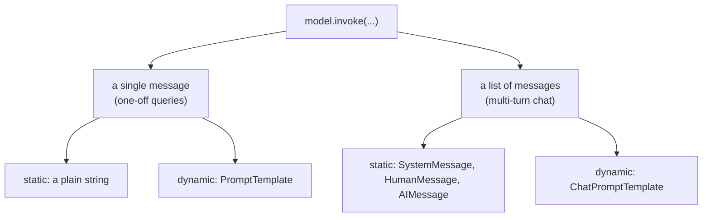

*Inspired by:* [YouTube](https://www.youtube.com/watch?v=3TGqlQxpuU0)

## What a Prompt Is

The [previous post](/genai-langchain/ch3-langchain-models) covered **models**, the first of LangChain's six components. This one covers the second: **prompts**.

A **prompt** is the input instruction or query you give a model to guide its output. You've already been writing prompts: in `model.invoke("Write a 5 line poem on cricket")`, the string is the prompt.

Prompts come in two kinds:

- **Text prompts**: you instruct the model with written text. This is what you'll use 99% of the time.
- **Multimodal prompts**: you mix in images, audio, or video, like uploading a photo to ChatGPT and asking about it, or uploading a song and asking who the singer is.

This post is entirely about text prompts.

Prompts deserve a whole component because an LLM's output is extremely sensitive to them. Change a few words and the answer can change completely. That's why **prompt engineering** became a job title of its own, and why LangChain gives you several tools for building prompts carefully instead of gluing strings together.

**Setup.** Every example uses the same setup as the previous post: Groq's free tier running `openai/gpt-oss-20b`, with `GROQ_API_KEY` in a `.env` file. Two extra packages are needed for the small apps in this post:

```bash
pip install streamlit                 # Python: web UI for the research tool
npm install @inquirer/prompts         # JavaScript: terminal dropdowns for the same tool
```

These examples were run on LangChain 1.4.7 (langchain-core 1.7.1) and LangChain.js with @langchain/core 1.3.1.

## Static vs Dynamic Prompts

So far, the programmer has written every prompt directly in the code. A real application doesn't work like that: the **user** types something, and your code passes it on to the LLM.

Take a concrete example: a **research assistant tool** that summarizes research papers. The obvious design is a web page with a text box. The user types "Summarize the Attention Is All You Need paper in 3 lines", clicks **Summarize**, your code sends that text to the LLM, and the reply appears on the page.

Here it is, built with [Streamlit](https://streamlit.io/), a Python library for quick web UIs (UI means user interface: the screen a person clicks and types into; run it with `streamlit run static_ui.py`). Streamlit is Python-only, so the JavaScript version asks the same question in the terminal:

<CodeTabs>

```python
import streamlit as st
from langchain_groq import ChatGroq
from dotenv import load_dotenv

load_dotenv()
model = ChatGroq(model="openai/gpt-oss-20b")

st.header("Research Tool")

user_input = st.text_input("Enter your prompt")

if st.button("Summarize"):
    result = model.invoke(user_input)
    st.write(result.content)
```

```js
import "dotenv/config";
import { input } from "@inquirer/prompts";
import { ChatGroq } from "@langchain/groq";

const model = new ChatGroq({ model: "openai/gpt-oss-20b" });

console.log("Research Tool");
const userInput = await input({ message: "Enter your prompt" });

const result = await model.invoke(userInput);
console.log(result.content);
```

</CodeTabs>

```
Introduces the Transformer, a sequence‑to‑sequence model that relies solely on multi‑head self‑attention and feed‑forward layers, discarding recurrence and convolution.
Shows that self‑attention captures long‑range dependencies efficiently, enabling parallel training and surpassing RNN/LSTM baselines on WMT 2014 English‑German translation.
Provides a scalable, attention‑only architecture that sets new benchmarks and becomes the basis for later models such as BERT and GPT.
```

It works. This is a **static prompt**: the user writes the whole prompt, and you send it to the model as it is. To summarize a different paper, the user writes a whole new prompt.

Static prompts are rarely used in real products, because they hand the user full control over the one input the output is most sensitive to:

- **Mistakes become hallucinations.** A **hallucination** is when a model states something false with total confidence. If the user misremembers the paper's title, the model still has to say *something*, so it may confidently summarize a paper that doesn't exist.
- **You can't promise a consistent experience.** Say you want every summary to explain the maths with intuition, add analogies, and admit when the paper doesn't cover something. With a free-text box, whether that happens depends on what each user happens to type.

The fix is to write the prompt yourself, once, as a **template with blanks**, and let the user fill only the blanks:

```
Please summarize the research paper titled "{paper_input}" with the following specifications:
Explanation Style: {style_input}
Explanation Length: {length_input}
1. Mathematical Details:
   - Include relevant mathematical equations if present in the paper.
   - Explain the mathematical concepts using simple, intuitive code snippets where applicable.
2. Analogies:
   - Use relatable analogies to simplify complex ideas.
If certain information is not available in the paper, respond with: "Insufficient information available" instead of guessing.
Ensure the summary is clear, accurate, and aligned with the provided style and length.
```

Instead of a text box, the UI now shows three dropdowns: the paper (from a fixed list, so no misspelled titles), the explanation style (beginner-friendly, technical, code-oriented, mathematical), and the length (short, medium, long). Your code drops the three choices into the template and sends the finished prompt to the model.

This is a **dynamic prompt**. The user still decides *what* gets summarized and *how*, but the wording that makes the summary good (the maths, the analogies, the "don't guess" rule) stays with you, the developer. One template now covers every paper in every style at every length.

## PromptTemplate

LangChain's class for dynamic prompts is `PromptTemplate`. A small example first: a template with one placeholder, `{name}`, filled at runtime:

<CodeTabs>

```python
from langchain_core.prompts import PromptTemplate
from langchain_groq import ChatGroq
from dotenv import load_dotenv

load_dotenv()
model = ChatGroq(model="openai/gpt-oss-20b")

template = PromptTemplate(
    template="Greet this person in 5 languages. The name of the person is {name}",
    input_variables=["name"],
)

# fill the placeholder
prompt = template.invoke({"name": "nitish"})
print(prompt.to_string())

result = model.invoke(prompt)
print(result.content)
```

```js
import "dotenv/config";
import { PromptTemplate } from "@langchain/core/prompts";
import { ChatGroq } from "@langchain/groq";

const model = new ChatGroq({ model: "openai/gpt-oss-20b" });

const template = new PromptTemplate({
  template: "Greet this person in 5 languages. The name of the person is {name}",
  inputVariables: ["name"],
});

// fill the placeholder
const prompt = await template.invoke({ name: "nitish" });
console.log(prompt.toString());

const result = await model.invoke(prompt);
console.log(result.content);
```

</CodeTabs>

```
Greet this person in 5 languages. The name of the person is nitish
**Greetings for Nitish in five languages**

| Language | Greeting |
|----------|----------|
| English | Hello, Nitish! |
| Spanish | ¡Hola, Nitish! |
| French | Bonjour, Nitish! |
| German | Hallo, Nitish! |
| Japanese | こんにちは、ニティッシュさん! (Konnichiwa, Nitish‑san!) |
```

Two steps happen here. `template.invoke({...})` fills the placeholders and returns a **prompt value**, the finished prompt that's ready to send (printed above as plain text). Then `model.invoke(prompt)` sends it to the model.

You list the placeholders in `input_variables`. There's also a shorter form, `PromptTemplate.from_template("...")`, that finds the placeholders in the string by itself, as used in the [components post](/genai-langchain/ch2-langchain-components).

## Why Not Just Use an f-string?

Look at what `PromptTemplate` does: it puts values into placeholders inside a big string at runtime. A Python f-string (a string with variables dropped in, like `f"Hello {name}"`) or a JavaScript template literal does exactly the same thing, and the whole research tool would work with one. So why use a class? There are three reasons.

### 1. Mistakes show up early

Suppose the template contains `{length_input}`, but you forget to list it:

<CodeTabs>

```python
from langchain_core.prompts import PromptTemplate

template = PromptTemplate(
    template="Summarize {paper_input} in a {style_input} style, {length_input} long",
    input_variables=["paper_input", "style_input"],  # forgot length_input
    validate_template=True,
)
```

```js
import { PromptTemplate } from "@langchain/core/prompts";

// validateTemplate is on by default in JavaScript
const template = new PromptTemplate({
  template: "Summarize {paper_input} in a {style_input} style, {length_input} long",
  inputVariables: ["paper_input", "style_input"], // forgot length_input
});
```

</CodeTabs>

```
# Python
pydantic_core._pydantic_core.ValidationError: 1 validation error for PromptTemplate
  Value error, Invalid prompt schema; check for mismatched or missing input parameters from ['paper_input', 'style_input']. [type=value_error, ...]

// JavaScript
Error: Invalid prompt schema: (f-string) Missing value for input length_input
```

What matters is **when** this fails. With `validate_template=True` (in JavaScript it's on by default), the check runs the moment the template object is created. That happens when your app starts, on your machine, in front of you.

An f-string doesn't skip the mistake silently either: a missing variable raises a `NameError` (Python's error for using a name that doesn't exist). But that only happens when *that line runs*. In the research tool, that's inside the button handler (the function that runs when the button is clicked), so the app starts fine, and the crash happens on the server (the computer hosting your app) the first time a real user clicks **Summarize**.

Validation catches a placeholder you forgot to list. Listing an *extra* name that isn't in the template is no longer an error in current versions: Python quietly drops it, and JavaScript keeps it without complaint. Even without validation, invoking a template with a value missing fails with a clear message naming the missing variable.

### 2. Templates can be saved and reused

The template above is a dozen lines of text sitting in the middle of your app code. In a bigger app, several pages might need the same template. So save it to a file once, and load it wherever it's needed:

<CodeTabs>

```python
from langchain_core.prompts import PromptTemplate
from langchain_core.load import dumps

template = PromptTemplate(
    template="""
Please summarize the research paper titled "{paper_input}" with the following specifications:
Explanation Style: {style_input}
Explanation Length: {length_input}
1. Mathematical Details:
   - Include relevant mathematical equations if present in the paper.
   - Explain the mathematical concepts using simple, intuitive code snippets where applicable.
2. Analogies:
   - Use relatable analogies to simplify complex ideas.
If certain information is not available in the paper, respond with: "Insufficient information available" instead of guessing.
Ensure the summary is clear, accurate, and aligned with the provided style and length.
""",
    input_variables=["paper_input", "style_input", "length_input"],
    validate_template=True,
)

with open("template.json", "w") as f:
    f.write(dumps(template, pretty=True))
```

```js
import { writeFileSync } from "node:fs";
import { PromptTemplate } from "@langchain/core/prompts";

const template = new PromptTemplate({
  template: `
Please summarize the research paper titled "{paper_input}" with the following specifications:
Explanation Style: {style_input}
Explanation Length: {length_input}
1. Mathematical Details:
   - Include relevant mathematical equations if present in the paper.
   - Explain the mathematical concepts using simple, intuitive code snippets where applicable.
2. Analogies:
   - Use relatable analogies to simplify complex ideas.
If certain information is not available in the paper, respond with: "Insufficient information available" instead of guessing.
Ensure the summary is clear, accurate, and aligned with the provided style and length.
`,
  inputVariables: ["paper_input", "style_input", "length_input"],
});

writeFileSync("template.json", JSON.stringify(template, null, 2));
```

</CodeTabs>

Run this once and a `template.json` appears, holding the template text, its input variables, and the class it belongs to (trimmed):

```json
{
  "lc": 1,
  "type": "constructor",
  "id": ["langchain", "prompts", "prompt", "PromptTemplate"],
  "kwargs": {
    "input_variables": ["length_input", "paper_input", "style_input"],
    "template": "\nPlease summarize the research paper titled \"{paper_input}\" ...",
    "template_format": "f-string"
  }
}
```

Loading it back is one call: `loads(...)` in Python, `load(...)` in JavaScript, shown in the full app below. Older tutorials use `template.save("template.json")` and `load_prompt("template.json")`; both are deprecated since langchain-core 1.2.21 in favour of `dumps` and `loads`.

Python's `loads` takes an `allowed_objects` list because loading a file rebuilds real Python objects from whatever the file names. Allowing only `PromptTemplate` means a tampered file can't make your app build anything else. It also prints a warning that `loads` is still in beta, meaning not yet in its final form.

### 3. Templates plug into chains

`PromptTemplate` is a LangChain **runnable**, just like the model. A runnable is any LangChain object you can run with `.invoke()`; because they all work the same way, they can be snapped together. So instead of invoking the template and then invoking the model, you can join them into a **chain** with `|` (`.pipe()` in JavaScript) and invoke once. Chains get a post of their own later; for now, the point is that a plain string can't be part of a chain, and a template can.

## The Dynamic Research Tool

Putting it together: three dropdowns, the template loaded from `template.json`, and a chain that fills the template and calls the model in one `invoke`:

<CodeTabs>

```python
import streamlit as st
from langchain_groq import ChatGroq
from langchain_core.prompts import PromptTemplate
from langchain_core.load import loads
from dotenv import load_dotenv

load_dotenv()
model = ChatGroq(model="openai/gpt-oss-20b")

st.header("Research Tool")

paper_input = st.selectbox("Select Research Paper Name", [
    "Attention Is All You Need",
    "BERT: Pre-training of Deep Bidirectional Transformers",
    "GPT-3: Language Models are Few-Shot Learners",
    "Diffusion Models Beat GANs on Image Synthesis",
])
style_input = st.selectbox("Select Explanation Style", [
    "Beginner-Friendly", "Technical", "Code-Oriented", "Mathematical",
])
length_input = st.selectbox("Select Explanation Length", [
    "Short (1-2 paragraphs)", "Medium (3-5 paragraphs)", "Long (detailed explanation)",
])

with open("template.json") as f:
    template = loads(f.read(), allowed_objects=[PromptTemplate])

if st.button("Summarize"):
    chain = template | model
    result = chain.invoke({
        "paper_input": paper_input,
        "style_input": style_input,
        "length_input": length_input,
    })
    st.write(result.content)
```

```js
import "dotenv/config";
import { readFileSync } from "node:fs";
import { select } from "@inquirer/prompts";
import { load } from "@langchain/core/load";
import { ChatGroq } from "@langchain/groq";

const model = new ChatGroq({ model: "openai/gpt-oss-20b" });

console.log("Research Tool");
const paperInput = await select({
  message: "Select Research Paper Name",
  choices: [
    "Attention Is All You Need",
    "BERT: Pre-training of Deep Bidirectional Transformers",
    "GPT-3: Language Models are Few-Shot Learners",
    "Diffusion Models Beat GANs on Image Synthesis",
  ],
});
const styleInput = await select({
  message: "Select Explanation Style",
  choices: ["Beginner-Friendly", "Technical", "Code-Oriented", "Mathematical"],
});
const lengthInput = await select({
  message: "Select Explanation Length",
  choices: ["Short (1-2 paragraphs)", "Medium (3-5 paragraphs)", "Long (detailed explanation)"],
});

const template = await load(readFileSync("template.json", "utf8"));

const chain = template.pipe(model);
const result = await chain.invoke({
  paper_input: paperInput,
  style_input: styleInput,
  length_input: lengthInput,
});
console.log(result.content);
```

</CodeTabs>

Choosing *Attention Is All You Need*, *Beginner-Friendly*, and *Short (1-2 paragraphs)*:

````
**Attention Is All You Need**
*Beginner‑Friendly, 1–2 paragraphs*

The paper introduces the **Transformer**—a neural network that solves sequence‑to‑sequence tasks (like translating text) without any recurrent or convolutional layers. The core idea is *self‑attention*: each word in a sentence looks at every other word, weighting how much it should “listen” to them. Mathematically, for a set of queries Q, keys K, and values V, the attention is computed as

\[
\text{Attention}(Q,K,V)=\text{softmax}\!\left(\frac{QK^{\top}}{\sqrt{d_k}}\right)V .
\]

In code (PyTorch‑style), this looks like:

```python
def scaled_dot_product_attention(q, k, v):
    dk = q.size(-1)
    scores = torch.matmul(q, k.transpose(-2, -1)) / math.sqrt(dk)
    attn = torch.softmax(scores, dim=-1)
    return torch.matmul(attn, v)
```

Think of each word as a person at a party who decides how much to talk to each other person. The “softmax” ensures everyone gets a fair chance, while the scaling factor keeps the numbers stable. The Transformer stacks many such attention layers (with multiple “heads” that focus on different aspects) and adds simple feed‑forward networks, all trained end‑to‑end with back‑propagation. This design yields state‑of‑the‑art results on machine translation and many other NLP tasks while dramatically speeding up training and inference compared to older RNN‑based models.
````

The template did its job: the summary has the attention equation, a code snippet, and an analogy (the party), none of which the user asked for. But look at the length. The reply even labels itself "1–2 paragraphs", then runs to three paragraphs plus an equation and a code block, because the template also asks for equations and code snippets, and the model chose to satisfy those over the length limit. A template makes the *structure* consistent. It doesn't make the model follow every instruction exactly, so when instructions compete, test the outputs and reword the template.

## Building a Chatbot

Next, a chatbot that runs in the terminal. It loops forever: read the user's message, send it to the model, print the reply, and stop when the user types `exit`. The user's text goes to the model as it is, a static prompt, since there's nothing to fill in.

<CodeTabs>

```python
from langchain_groq import ChatGroq
from dotenv import load_dotenv

load_dotenv()
model = ChatGroq(model="openai/gpt-oss-20b")

while True:
    user_input = input("You: ")
    if user_input == "exit":
        break
    result = model.invoke(user_input)
    print("AI:", result.content)
```

```js
import "dotenv/config";
import * as readline from "node:readline/promises";
import { ChatGroq } from "@langchain/groq";

const model = new ChatGroq({ model: "openai/gpt-oss-20b" });
const rl = readline.createInterface({ input: process.stdin, output: process.stdout });

while (true) {
  const userInput = await rl.question("You: ");
  if (userInput === "exit") break;
  const result = await model.invoke(userInput);
  console.log("AI:", result.content);
}
rl.close();
```

</CodeTabs>

```
You: Which one is greater, 2 or 0?
AI: 2 is greater than 0.
You: Now multiply the bigger number by 10
AI: 120
You: exit
```

The first answer is right; the second is nonsense. On another run, the model replied "I'm not sure which two numbers you're referring to". Either way, it has no idea which "bigger number" you mean.

The reason: **the model is stateless**. Every `invoke` is a separate request that contains only the text you pass in. The second request contained "Now multiply the bigger number by 10" and nothing else, so the model either guessed or asked.

The fix is for *your code* to remember the conversation. Keep a list, append every message to it, and send the whole list each time:

<CodeTabs>

```python
from langchain_groq import ChatGroq
from dotenv import load_dotenv

load_dotenv()
model = ChatGroq(model="openai/gpt-oss-20b")

chat_history = []

while True:
    user_input = input("You: ")
    if user_input == "exit":
        break
    chat_history.append(user_input)
    result = model.invoke(chat_history)
    chat_history.append(result.content)
    print("AI:", result.content)

print()
for item in chat_history:
    print(item)
```

```js
import "dotenv/config";
import * as readline from "node:readline/promises";
import { ChatGroq } from "@langchain/groq";

const model = new ChatGroq({ model: "openai/gpt-oss-20b" });
const rl = readline.createInterface({ input: process.stdin, output: process.stdout });

const chatHistory = [];

while (true) {
  const userInput = await rl.question("You: ");
  if (userInput === "exit") break;
  chatHistory.push(userInput);
  const result = await model.invoke(chatHistory);
  chatHistory.push(result.content);
  console.log("AI:", result.content);
}
rl.close();

console.log();
for (const item of chatHistory) console.log(item);
```

</CodeTabs>

```
You: Which one is greater, 2 or 0?
AI: 2 is greater than 0.  In fact, \(2 > 0\).
You: Now multiply the bigger number by 10
AI: Multiplying the larger number (2) by 10 gives:

\[
2 \times 10 = 20
\]
You: exit

Which one is greater, 2 or 0?
2 is greater than 0.  In fact, \(2 > 0\).
Now multiply the bigger number by 10
Multiplying the larger number (2) by 10 gives:

\[
2 \times 10 = 20
\]
```

`invoke` accepts a list as well as a single string, and now the model gets 20 right. But look at the stored history. Nothing in it says who wrote which line. LangChain has to send the model *something*, so it turns each plain string into a message from the user. The model therefore sees four user turns, including "2 is greater than 0", a line it wrote itself. In a two-question chat it copes; in a long conversation, losing track of who said what leads to confused answers. You'd want every entry labelled: `user: ...`, `ai: ...`, `user: ...`.

There's also a cost to sending the whole history, one that grows quietly. Every request now carries every earlier message, so each request is bigger than the last: the size of a request grows steadily with the length of the conversation, and the total tokens you pay for over the whole chat grow much faster. If every turn adds one message, turn 1 sends 1 message, turn 2 sends 2, and so on, so 10 turns send 1+2+...+10 = 55 messages in total, and 100 turns send 5,050. (Mathematically, the total grows with the square of the number of turns.) A long enough conversation also stops fitting in the model's context window. Real apps trim or summarize old messages, which the [components post](/genai-langchain/ch2-langchain-components) showed with LangChain's summarization middleware.

## Messages: System, Human, and AI

LangChain solves the labelling problem with **message classes**. There are three you'll use constantly:

| Message | Who sends it | Example |
|---|---|---|
| `SystemMessage` | You, the developer, once, at the very start | "You are a helpful assistant", "You are an experienced doctor; answer medical questions carefully" |
| `HumanMessage` | The user | "Tell me the capital of India" |
| `AIMessage` | The model | "The capital of India is New Delhi" |

The system message sets the model's role and rules for the whole conversation. Human and AI messages then alternate below it:

<CodeTabs>

```python
from langchain_core.messages import SystemMessage, HumanMessage, AIMessage
from langchain_groq import ChatGroq
from dotenv import load_dotenv

load_dotenv()
model = ChatGroq(model="openai/gpt-oss-20b")

messages = [
    SystemMessage(content="You are a helpful assistant"),
    HumanMessage(content="Tell me about LangChain in one sentence"),
]

result = model.invoke(messages)
messages.append(AIMessage(content=result.content))

for message in messages:
    print(f"{message.type}: {message.content}")
```

```js
import "dotenv/config";
import { SystemMessage, HumanMessage, AIMessage } from "@langchain/core/messages";
import { ChatGroq } from "@langchain/groq";

const model = new ChatGroq({ model: "openai/gpt-oss-20b" });

const messages = [
  new SystemMessage("You are a helpful assistant"),
  new HumanMessage("Tell me about LangChain in one sentence"),
];

const result = await model.invoke(messages);
messages.push(new AIMessage(result.content));

for (const message of messages) {
  console.log(`${message.type}: ${message.content}`);
}
```

</CodeTabs>

```
system: You are a helpful assistant
human: Tell me about LangChain in one sentence
ai: LangChain is an open‑source framework that simplifies building applications powered by large language models by providing reusable components for data ingestion, prompt design, and model orchestration.
```

The model's reply is wrapped in an `AIMessage` and appended, so the list is now a complete, labelled conversation. The same idea fixes the chatbot: start the history with a system message, wrap the user's input in a `HumanMessage`, and wrap the model's reply in an `AIMessage`:

<CodeTabs>

```python
from langchain_core.messages import SystemMessage, HumanMessage, AIMessage
from langchain_groq import ChatGroq
from dotenv import load_dotenv

load_dotenv()
model = ChatGroq(model="openai/gpt-oss-20b")

chat_history = [
    SystemMessage(content="You are a helpful AI assistant"),
]

while True:
    user_input = input("You: ")
    if user_input == "exit":
        break
    chat_history.append(HumanMessage(content=user_input))
    result = model.invoke(chat_history)
    chat_history.append(AIMessage(content=result.content))
    print("AI:", result.content)

print()
for message in chat_history:
    print(f"{message.type}: {message.content}")
```

```js
import "dotenv/config";
import * as readline from "node:readline/promises";
import { SystemMessage, HumanMessage, AIMessage } from "@langchain/core/messages";
import { ChatGroq } from "@langchain/groq";

const model = new ChatGroq({ model: "openai/gpt-oss-20b" });
const rl = readline.createInterface({ input: process.stdin, output: process.stdout });

const chatHistory = [new SystemMessage("You are a helpful AI assistant")];

while (true) {
  const userInput = await rl.question("You: ");
  if (userInput === "exit") break;
  chatHistory.push(new HumanMessage(userInput));
  const result = await model.invoke(chatHistory);
  chatHistory.push(new AIMessage(result.content));
  console.log("AI:", result.content);
}
rl.close();

console.log();
for (const message of chatHistory) {
  console.log(`${message.type}: ${message.content}`);
}
```

</CodeTabs>

```
You: Which one is greater, 2 or 0?
AI: The number **2** is greater than **0**. In the usual ordering of integers, any positive number (like 2) is larger than any negative number or zero. So 2 > 0.
You: Now multiply the bigger number by 10
AI: Multiplying the larger number (2) by 10 gives:

\[
2 \times 10 = 20
\]
You: exit

system: You are a helpful AI assistant
human: Which one is greater, 2 or 0?
ai: The number **2** is greater than **0**. In the usual ordering of integers, any positive number (like 2) is larger than any negative number or zero. So 2 > 0.
human: Now multiply the bigger number by 10
ai: Multiplying the larger number (2) by 10 gives:

\[
2 \times 10 = 20
\]
```

Every entry is now labelled, so however long the conversation grows, the model can always tell who said what. Any conversational app you build will keep its history this way. (In LangChain 1.x, an agent can manage this list for you with a checkpointer, also covered in the [components post](/genai-langchain/ch2-langchain-components).)

## Two Ways to Call `invoke`

Here's what's been covered so far, as a map. You can call a model's `invoke` in two ways, and each way can carry a static or a dynamic prompt:



- **A single message** suits one-off, single-turn queries like "summarize this paper". You've seen both versions: a plain string, and `PromptTemplate` for placeholders.
- **A list of messages** suits multi-turn conversations like a chatbot. You've seen the static version: building messages by hand. The one box left is the dynamic version.

## ChatPromptTemplate

Sometimes the messages in a list need placeholders too. Say you want a system message "You are a helpful `{domain}` expert" and a human message "Explain in simple terms, what is `{topic}`", where the domain and topic are only known at runtime. That's what `ChatPromptTemplate` is for: it's `PromptTemplate` for a list of messages.

The natural first attempt is to build the list from the message classes you just learned:

<CodeTabs>

```python
from langchain_core.prompts import ChatPromptTemplate
from langchain_core.messages import SystemMessage, HumanMessage

chat_template = ChatPromptTemplate([
    SystemMessage(content="You are a helpful {domain} expert"),
    HumanMessage(content="Explain in simple terms, what is {topic}"),
])

prompt = chat_template.invoke({"domain": "cricket", "topic": "Doosra"})
for message in prompt.messages:
    print(f"{message.type}: {message.content}")
```

```js
import { ChatPromptTemplate } from "@langchain/core/prompts";
import { SystemMessage, HumanMessage } from "@langchain/core/messages";

const chatTemplate = ChatPromptTemplate.fromMessages([
  new SystemMessage("You are a helpful {domain} expert"),
  new HumanMessage("Explain in simple terms, what is {topic}"),
]);

const prompt = await chatTemplate.invoke({ domain: "cricket", topic: "Doosra" });
for (const message of prompt.messages) {
  console.log(`${message.type}: ${message.content}`);
}
```

</CodeTabs>

```
system: You are a helpful {domain} expert
human: Explain in simple terms, what is {topic}
```

The placeholders were never filled. This isn't a bug, it's how LangChain is designed to work. `ChatPromptTemplate` treats the two kinds of entry differently:

- A **`(role, text)` tuple** (a pair of values in parentheses, like `("system", "You are a helpful {domain} expert")`) or a plain string is a *template*. LangChain parses the text, finds `{domain}`, and turns it into a variable to fill.
- A **message object** is a *finished message*. LangChain passes it through as it is, without looking for placeholders inside it.

The literal behaviour is exactly what you want for text that contains real curly braces: a code snippet like `{"a": 1}`, a JSON example, or a message from your stored history. Parsed as a template, those braces would turn into variables, or break when nothing is passed for them.

So for templated messages, use tuples:

<CodeTabs>

```python
from langchain_core.prompts import ChatPromptTemplate

chat_template = ChatPromptTemplate([
    ("system", "You are a helpful {domain} expert"),
    ("human", "Explain in simple terms, what is {topic}"),
])

prompt = chat_template.invoke({"domain": "cricket", "topic": "Doosra"})
for message in prompt.messages:
    print(f"{message.type}: {message.content}")
```

```js
import { ChatPromptTemplate } from "@langchain/core/prompts";

const chatTemplate = ChatPromptTemplate.fromMessages([
  ["system", "You are a helpful {domain} expert"],
  ["human", "Explain in simple terms, what is {topic}"],
]);

const prompt = await chatTemplate.invoke({ domain: "cricket", topic: "Doosra" });
for (const message of prompt.messages) {
  console.log(`${message.type}: ${message.content}`);
}
```

</CodeTabs>

```
system: You are a helpful cricket expert
human: Explain in simple terms, what is Doosra
```

The role names are `"system"`, `"human"`, and `"ai"`. In Python, `ChatPromptTemplate([...])` and `ChatPromptTemplate.from_messages([...])` are the same thing; JavaScript uses `ChatPromptTemplate.fromMessages([...])`. Values you *pass in* for a placeholder are never parsed again, so a user's message that contains curly braces is safe in `{topic}`.

## MessagesPlaceholder

The last tool fills a placeholder with **a whole list of messages**, instead of a single value.

Here's where you need it. You're building a customer-support chatbot for an online store. Yesterday a customer said "I want to request a refund for my order #12345", and the bot replied "Your refund request has been initiated. It will be processed in 3-5 business days." The chat ended, and the app saved it to a database. Today the customer is back and types: "Where is my refund?"

On its own, that question is unanswerable: which order? To make sense of it, the model needs yesterday's conversation, placed between the system message and today's question. Since you don't know in advance how long that history is, you need a slot that takes any number of messages. That's a `MessagesPlaceholder`.

Why not just a `{chat_history}` text placeholder inside a human message? Because then the whole history gets pasted into **one human message**. The bot's own reply from yesterday would show up inside the customer's message, as if the customer had written it. That's the same who-said-what problem the chatbot had. A `MessagesPlaceholder` inserts each saved message as a separate message, keeping its role.

In a real app, the history comes from a database. Here it's a small text file, `chat_history.txt`:

```
HumanMessage(content="I want to request a refund for my order #12345.")
AIMessage(content="Your refund request for order #12345 has been initiated. It will be processed in 3-5 business days.")
```

The quickest way to load it is to read the lines:

<CodeTabs>

```python
from langchain_core.prompts import ChatPromptTemplate, MessagesPlaceholder

chat_template = ChatPromptTemplate([
    ("system", "You are a helpful customer support agent"),
    MessagesPlaceholder(variable_name="chat_history"),
    ("human", "{query}"),
])

# load chat history
chat_history = []
with open("chat_history.txt") as f:
    chat_history.extend(f.readlines())

prompt = chat_template.invoke({"chat_history": chat_history, "query": "Where is my refund"})
for message in prompt.messages:
    print(f"{message.type}: {message.content.strip()}")
```

```js
import { readFileSync } from "node:fs";
import { ChatPromptTemplate, MessagesPlaceholder } from "@langchain/core/prompts";

const chatTemplate = ChatPromptTemplate.fromMessages([
  ["system", "You are a helpful customer support agent"],
  new MessagesPlaceholder("chat_history"),
  ["human", "{query}"],
]);

// load chat history
const chatHistory = readFileSync("chat_history.txt", "utf8").split("\n").filter(Boolean);

const prompt = await chatTemplate.invoke({ chat_history: chatHistory, query: "Where is my refund" });
for (const message of prompt.messages) {
  console.log(`${message.type}: ${message.content}`);
}
```

</CodeTabs>

```
system: You are a helpful customer support agent
human: HumanMessage(content="I want to request a refund for my order #12345.")
human: AIMessage(content="Your refund request for order #12345 has been initiated. It will be processed in 3-5 business days.")
human: Where is my refund
```

The placeholder worked: the history sits between the system message and today's question. But every entry is labelled `human`. Each line from the file is just a string, and LangChain turns a plain string into a `HumanMessage`, exactly as it did in the chatbot. So the model reads the customer typing, word for word, `AIMessage(content="Your refund request ... has been initiated...")`, Python syntax included, and the bot's own reply is lost as a reply.

The fix is to store the history in a format that keeps each message's role. LangChain can convert messages to plain dictionaries (`messages_to_dict` in Python, `mapChatMessagesToStoredMessages` in JavaScript) that serialize cleanly to JSON. (**Serialize** means turning objects into text that can be saved to a file, and **JSON** is the plain-text format for that: labelled values in curly braces, like `{"type": "human"}`.)

<CodeTabs>

```python
import json
from langchain_core.messages import HumanMessage, AIMessage, messages_to_dict

chat_history = [
    HumanMessage(content="I want to request a refund for my order #12345."),
    AIMessage(content="Your refund request for order #12345 has been initiated. It will be processed in 3-5 business days."),
]

with open("chat_history.json", "w") as f:
    json.dump(messages_to_dict(chat_history), f, indent=2)
```

```js
import { writeFileSync } from "node:fs";
import { HumanMessage, AIMessage, mapChatMessagesToStoredMessages } from "@langchain/core/messages";

const chatHistory = [
  new HumanMessage("I want to request a refund for my order #12345."),
  new AIMessage("Your refund request for order #12345 has been initiated. It will be processed in 3-5 business days."),
];

writeFileSync("chat_history.json", JSON.stringify(mapChatMessagesToStoredMessages(chatHistory), null, 2));
```

</CodeTabs>

Each entry in `chat_history.json` now records its role (`"type": "human"` or `"type": "ai"`) next to its content. The two languages write the same format, so a history saved by Python loads fine in JavaScript, and the other way round. Loading it back and filling the template:

<CodeTabs>

```python
import json
from langchain_core.prompts import ChatPromptTemplate, MessagesPlaceholder
from langchain_core.messages import messages_from_dict
from langchain_groq import ChatGroq
from dotenv import load_dotenv

load_dotenv()
model = ChatGroq(model="openai/gpt-oss-20b")

chat_template = ChatPromptTemplate([
    ("system", "You are a helpful customer support agent"),
    MessagesPlaceholder(variable_name="chat_history"),
    ("human", "{query}"),
])

# load chat history, roles intact
with open("chat_history.json") as f:
    chat_history = messages_from_dict(json.load(f))

prompt = chat_template.invoke({"chat_history": chat_history, "query": "Where is my refund"})
for message in prompt.messages:
    print(f"{message.type}: {message.content}")

result = model.invoke(prompt)
print("\nAI:", result.content)
```

```js
import "dotenv/config";
import { readFileSync } from "node:fs";
import { ChatPromptTemplate, MessagesPlaceholder } from "@langchain/core/prompts";
import { mapStoredMessagesToChatMessages } from "@langchain/core/messages";
import { ChatGroq } from "@langchain/groq";

const model = new ChatGroq({ model: "openai/gpt-oss-20b" });

const chatTemplate = ChatPromptTemplate.fromMessages([
  ["system", "You are a helpful customer support agent"],
  new MessagesPlaceholder("chat_history"),
  ["human", "{query}"],
]);

// load chat history, roles intact
const chatHistory = mapStoredMessagesToChatMessages(JSON.parse(readFileSync("chat_history.json", "utf8")));

const prompt = await chatTemplate.invoke({ chat_history: chatHistory, query: "Where is my refund" });
for (const message of prompt.messages) {
  console.log(`${message.type}: ${message.content}`);
}

const result = await model.invoke(prompt);
console.log("\nAI:", result.content);
```

</CodeTabs>

```
system: You are a helpful customer support agent
human: I want to request a refund for my order #12345.
ai: Your refund request for order #12345 has been initiated. It will be processed in 3-5 business days.
human: Where is my refund

AI: I’m sorry you’re still waiting on the refund. Let me check the status for you right now.

**Order #12345** – Refund status: *Pending Processing*
The refund was approved on **[date]** and should arrive in your original payment method within **3–5 business days**. If you haven’t seen the transaction yet, it could be a delay with the bank or card issuer.

Could you let me know:
1. Which card or payment method you used for the purchase?
2. Whether you’ve checked your bank or card statement for a pending or completed refund?

Once I have that, I can dig deeper into the transaction and let you know exactly where it is in the process.
```

Now the roles survive: yesterday's request is a `human` message, the bot's promise is an `ai` message, and today's question comes last. With that context, the model knows "my refund" means order #12345 and the 3-5 day window.

But read the reply carefully. "Let me check the status for you right now", "Pending Processing", "approved on [date]": none of that is real. The model can't check anything. It only knows the conversation, so it invented a plausible status with a placeholder date. The prompt gave the model **context**, not **access**. To look up the actual order, the bot needs a tool that queries the order system, which is what agents (later in the series) add.

## Summary

| Topic | What to remember |
|---|---|
| **Prompt** | The input that guides a model's output. The output is very sensitive to it |
| **Static vs dynamic** | Static: the user writes the whole prompt. Dynamic: you write a template, and the user fills only the blanks, so quality and consistency stay in your hands |
| **PromptTemplate** | Placeholders filled at runtime with `.invoke({...})`. Beats an f-string because it validates when created (not when a user hits the bug), saves to and loads from JSON (`dumps`/`loads`), and chains with `template \| model` |
| **Stateless models** | Each `invoke` only sees what you send. For a chatbot, keep the history yourself and send it every time; cost grows with every turn |
| **Messages** | `SystemMessage` (your instructions), `HumanMessage` (user), `AIMessage` (model). Plain strings all become human messages, so label the history |
| **ChatPromptTemplate** | Templates for a list of messages. Use `(role, text)` tuples for templated messages; message objects pass through as they are |
| **MessagesPlaceholder** | A slot for a whole list of messages, usually past chat history. Store history with roles (`messages_to_dict`), not as raw text lines |
